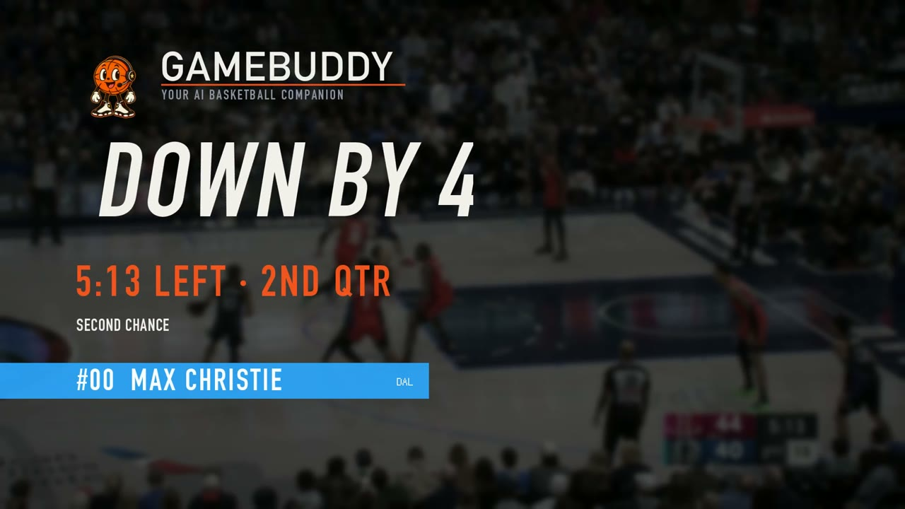
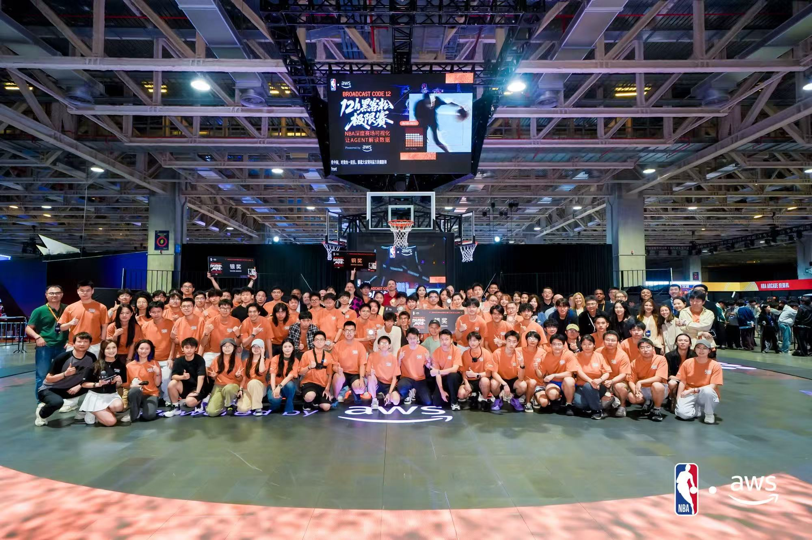
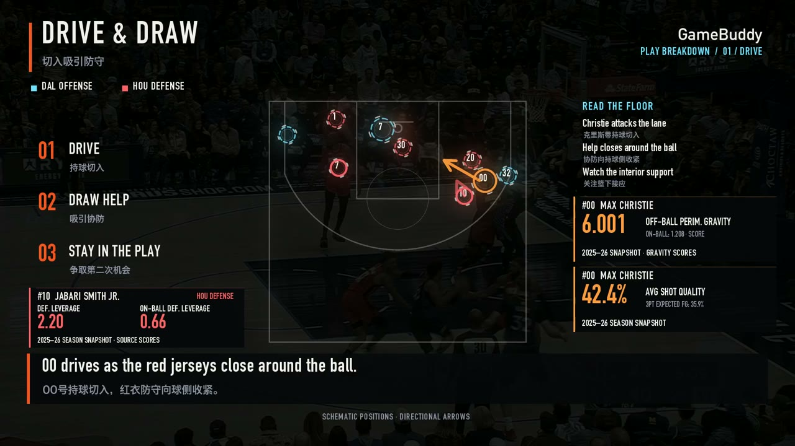
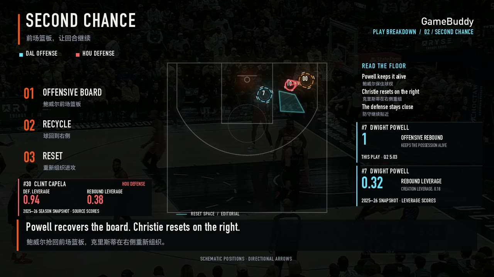
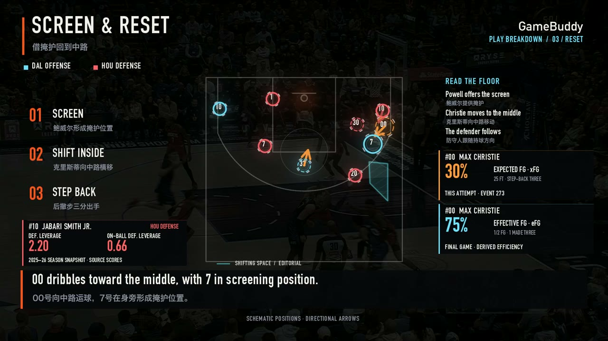
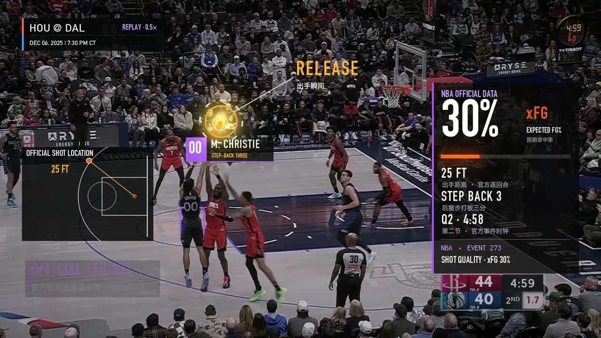
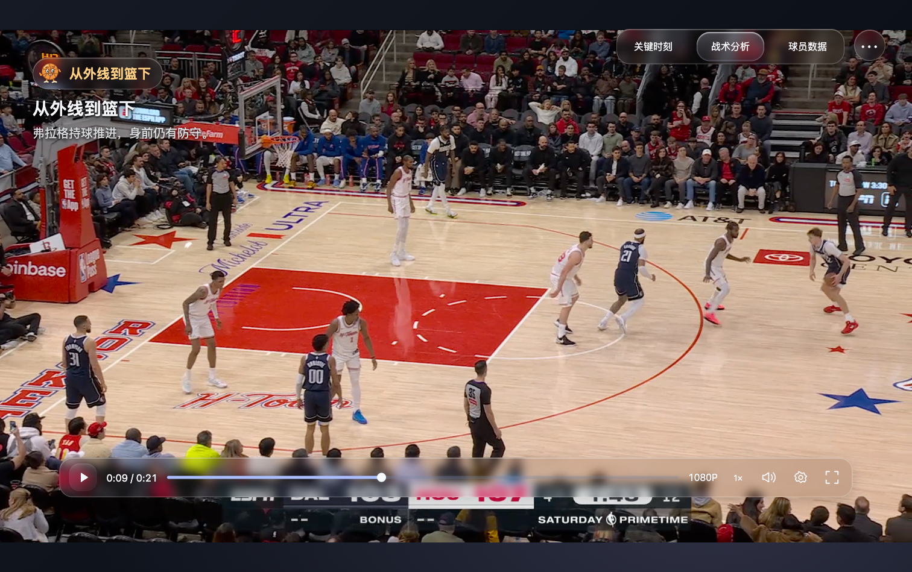
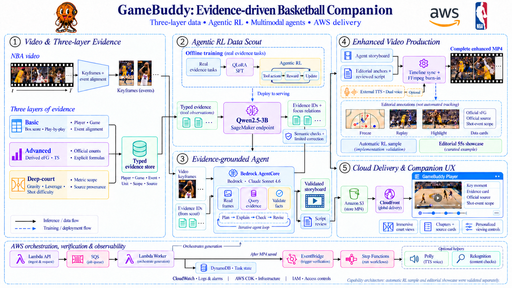
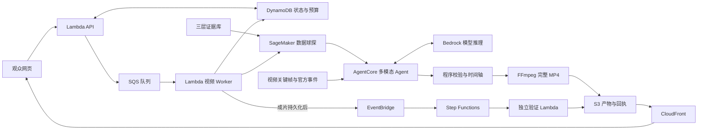

<div align="center">

# 🏀 GameBuddy

### Your AI Basketball Buddy · 陪你看懂每一个回合

**三层篮球数据 × Agentic RL 数据球探 × 多模态 Agent × 增强视频**

把一次进攻，变成有画面依据、有数据支撑、可以回看的篮球故事。

<p>
  
  
</p>

<p>
  <a href="#quick-start"></a>
  <a href="#stack"></a>
  <a href="#scout"></a>
  <a href="#aws"></a>
  <a href="LICENSE"></a>
</p>

<p>
  <a href="https://deky02484tknr.cloudfront.net/"><strong>比赛展示</strong></a> ·
  <a href="#demo"><strong>演示画面</strong></a> ·
  <a href="#architecture"><strong>技术架构</strong></a> ·
  <a href="#quick-start"><strong>快速开始</strong></a> ·
  <a href="docs/README.md"><strong>文档导航</strong></a>
</p>



<sub>2026 NBA × AWS BroadcastCode 12h 黑客松 · Team02 · 银奖</sub>

</div>

## 🥈 从黑客松到 GameBuddy

GameBuddy 获得本次 **NBA × AWS 黑客松银奖**。我们围绕一个问题开发这款产品：比赛很快，观众怎样才能在看完一个回合后，多理解一个刚才没有注意到的细节？

一次进球背后，可能有被忽略的无球站位、前场篮板、掩护重组和防守回应。GameBuddy 将这些观看重点与真实篮球数据联系起来，通过完整视频、战术暂停、数据卡和 AI 解说，让回合变得容易读懂。

<p align="center">
  
  <br/><sub>比赛合影 · 由团队提供，保留原图。</sub>
</p>

本仓库保留产品前端、Agent、模型训练、视频渲染、AWS 基础设施及实际运行记录。比赛期在线展示与云推理有不同的可用期限；开源复现以本地预览和源代码为起点。

## 📌 一眼看懂

```text
比赛视频 + 官方事件
        ↓
基础数据 / 高阶派生 / 深度赛场 → 统一证据库
        ↓
3B 数据球探选择证据 → 多模态 Agent 读图、查证与组织解读
        ↓
程序校验数值与统计范围 → 时间轴同步 → 完整 MP4 烧录
        ↓
S3 / CloudFront → GameBuddy 观赛网页
```

| 观众会看到 | 背后的实现 |
|---|---|
| 一个回合的关键人物与关键一拍 | 关键帧、章节回看、人物强调与分段视觉叙事 |
| 镜头转换为容易阅读的战术板 | 源画面中的编辑锚点、攻防配色和图形转场 |
| 得分、效率和角色背景一起出现 | 基础统计、eFG/TS 与 Gravity/Leverage/Shot Difficulty 的证据关联 |
| 出手回放时出现官方 xFG | 视频事件与官方 `actionNumber` 对齐，取数及来源校验 |
| 双人 AI 解说与陪伴式界面 | 审核后的脚本、TTS、音画对齐和 GameBuddy 篮球伙伴 |
| 可以保存、分享和独立检查的视频 | 标注永久烧录的 MP4，而非仅在网页上临时覆盖 |

<a id="demo"></a>

## 🎬 演示

正式作品围绕 **Max Christie 的二次进攻**展开：首攻被封盖，Dwight Powell 抢回前场篮板，球队重新组织，Christie 完成后撤步打板三分。约 23.78 秒的完整源回合，通过定格、回看和慢放展开为 **55.055 秒**的增强视频。

<table>
  <tr>
    <td width="50%"><br/><strong>看清攻防关系</strong><br/>人物提示配合深度数据卡，明确标注赛季背景。</td>
    <td width="50%"><br/><strong>关注终结之外的贡献</strong><br/>围绕前场篮板和右侧重组展开回合故事。</td>
  </tr>
  <tr>
    <td width="50%"><br/><strong>镜头进入战术板</strong><br/>通过编辑示意阅读掩护、移动与出手关系。</td>
    <td width="50%"><br/><strong>数据在关键时刻出现</strong><br/>本次出手 xFG 与整场效率、赛季背景分开呈现。</td>
  </tr>
</table>

上方配图截自最终本地英文答辩片；[配图来源与哈希](docs/assets/project/sources.json)记录截帧时间和媒体身份。比赛提交版本使用豆包双人语音，本地英文答辩版本使用 MOSS-TTS。两版的制作与验收分别记录，视频文件不随 Git 分发。

玻璃播放器支持沉浸式、全场和半场布局，配合章节、数据、来源与观赛设置；默认采用清透 CSS 毛玻璃，liquidGL 作为可选实验材质保留。

<p align="center">
  
  <br/><sub>观赛前端实机截图 · 弗拉格注册样片。</sub>
</p>

<a id="highlights"></a>

## ✨ 核心设计

| 设计 | 实现与价值 |
|---|---|
| **三层数据融合** | 将比赛事实、派生效率、机会质量及角色背景组织为同一套证据记录，同时保留不同的单位和统计范围。 |
| **Agentic RL 数据球探** | 基于 Qwen2.5-3B、QLoRA SFT 和分组策略梯度训练工具使用与证据选择，模型返回短证据 ID。 |
| **多模态 Agent 协作** | 视觉与叙事 Agent 读取真实帧和工具结果，通过规划、解释、校验、修订形成解读。 |
| **确定性事实校验** | 数字从来源记录复制；程序检查主体、指标、单位、时期和来源，按公式计算高阶指标。 |
| **回合视觉叙事** | 人物强调、战术暂停、镜头到俯视板转场、慢放、命中反馈和分时数据揭示共同组织观看节奏。 |
| **双时间轴** | 原片时间定位证据，成片时间安排定格和回放，明确记录两者映射。 |
| **陪伴式观赛** | 篮球伙伴、三态布局、章节回看和观赛偏好构成持续陪伴的交互。 |
| **完整增强视频** | 用 FFmpeg 永久烧录标注与数据；AI 解说按既定时间线合成。 |
| **AWS 异步交付** | 队列、任务状态、独立成片验收、缓存和告警将模型能力接入真实产品链路。 |

<a id="architecture"></a>

## 🏛 系统架构

<p align="center">
  
</p>

图中的五个模块分别承担：

1. **Video & Three-layer Evidence**：将视频关键帧、官方事件和三层数据关联，形成带来源的证据库。
2. **Agentic RL Data Scout**：离线训练数据球探，再通过 SageMaker 端点服务选择证据与受控关系。
3. **Evidence-grounded Agent**：AgentCore 托管工具型 Agent，Bedrock 模型读取画面、查询证据并修订叙事。
4. **Enhanced Video Production**：验证脚本与编辑锚点对齐时间轴，由 FFmpeg 输出完整增强 MP4。
5. **Cloud Delivery & Companion UX**：S3 保存产物，CloudFront 提供网页和视频，播放器支持继续探索。

底部的 Lambda、SQS、DynamoDB、EventBridge、Step Functions 和 CloudWatch 支撑任务调度、状态管理、验收与观测。

<details>
<summary>展开可编辑的数据流</summary>



</details>

这是一张整体能力架构图。**自动 RL 样片**完成了模型选证、Agent 叙事和视频烧录；**正式 55 秒作品**采用编辑视觉、AgentCore 稿件审核及双人解说。两条路径有各自的验收记录。

<a id="data"></a>

## 📊 从数据到解释

冻结证据库包含 **1,993 条记录**，关联 **33 位球员、4 场比赛**以及赛季背景。

| 数据层 | 记录数 | 内容 | 统计口径 |
|---|---:|---|---|
| 基础数据 | 1,513 | 得分、投篮计数、篮板、助攻、抢断等 | 对应比赛的官方统计 |
| 高阶派生 | 166 | eFG、TS | 基于官方操作数与明确公式计算 |
| 深度赛场 | 314 | Gravity 90、Leverage 160、Shot Difficulty 64 | NBA 赛季来源快照 |

**本次出手的官方 xFG 单独保存**，与赛季平均机会质量区分。统一证据字段包括：

```text
playerId · teamId · gameId · metric · value · unit
grain · period · source · evidenceId
```

数据球探选择 `evidenceId` 和允许的关系，程序从来源取数。eFG、TS 保存公式及操作数；缺失数据保留缺失状态，跨表比较要求指标、单位、时期及来源口径一致。

已验收的弗拉格自动样片同时使用 **本场 34 分、eFG 54.00%、赛季无球外线引力 6.217**；该次出手的官方 **xFG 51.0%** 独立展示。正式 Christie 片中，**event 273 的 xFG 30%**、全场派生效率和赛季深度分数也分别标注范围。

赛季快照用于回顾性球员背景。它不是该回合的实时测量，也不能作为本场赛前可用信息或单回合因果证明。Gravity 和 Leverage 按来源分数呈现，不换算为命中率或对位胜率。

<a id="scout"></a>

## 🧠 Agentic RL 数据球探

数据球探学习的是 **怎样调用篮球工具、选择相关证据并遵守语义边界**。视觉模型负责看画面，文本球探负责取证，确定性程序负责数字和最终显示。

```text
真实证据任务 → QLoRA 监督微调 → 分组强化学习
             → SageMaker 端点 → 工具调用 / 证据 ID / 关系
             → 语义校验与有限纠错 → Agent 叙事 → 视频烧录
```

| 项目 | 比赛期间实际实现 |
|---|---|
| 基础模型 | Qwen2.5-3B-Instruct |
| 训练平台 | 正式 AWS SageMaker，单台 `ml.g5.xlarge` / NVIDIA A10G |
| 监督训练 | 4-bit NF4 QLoRA，rank 16；640 次样本训练，291 条不同训练题 |
| RL 实验 | 30 轮采样、240 条轨迹、7 次实际权重更新 |
| 奖励与约束 | 结构化协议、工具返回证据、指标语义、可用性、关系及统计范围 |
| 产品运行 | 训练后模型 + 语义校验 + 最多一次模型纠错 |
| 已知案例验收 | 两段注册样片 × 三种深度关注方向，最终 6/6 通过，其中 1 次经过纠错 |
| 端到端实例 | 弗拉格任务实际选证 2.841 秒、2 次生成，三层证据进入叙事与完整 MP4 |

6/6 是已知案例上的**模型与程序组合验收**；2.841 秒是一次任务的取证耗时。它们不代表新比赛泛化准确率或统一延迟。

<details>
<summary>训练结果与实验限制</summary>

| 阶段 | 冻结验证集 | 冻结测试集 |
|---|---:|---:|
| 训练前 | 0/16 | 0/16 |
| SFT 后 | 15/16 | 16/16 |
| RL 后 | 15/16 | 16/16 |

SFT 改善了新工具协议与证据选择；本轮 **RL 相对 SFT 未观察到额外增益**。实验只有一个随机种子和每组 16 道题，四场比赛均用于开发。原始关键语义错误与未通过的发布门槛保留在报告中；后续受控产品调用的通过结果独立记录。

训练实现采用分组归一化优势，基于当前策略采样后进行单次策略梯度更新，没有实现带参考 KL 的完整 GRPO 或 clipped PPO。

依据：[训练结果](docs/RL三层联合训练结果-20261010.md) · [服务交付](docs/RL服务交付-20261010.md) · [端到端接入](docs/RL产品端到端联调验收-20261010.md)。

</details>

<a id="aws"></a>

## ☁️ AWS 服务协同

按项目业务能力口径使用 **13 项 AWS 能力**，AgentCore 与 Bedrock 分计；部署和身份支撑另列。Polly、Rekognition 为已实测的可选辅助，每个成片版本的实际调用范围分别记录。

| 服务 | 项目职责 |
|---|---|
| **Amazon Bedrock AgentCore** | 托管工具型 Agent，执行读图、查证、修订和稿件审核 |
| **Amazon Bedrock** | Claude Sonnet 4.6 多模态理解与叙事推理 |
| **Amazon SageMaker AI** | 数据球探训练、模型打包与实时端点推理 |
| **AWS Lambda** | Function URL API、视频 Worker、独立验证和可选语音处理 |
| **Amazon SQS** | 长任务排队、重试与死信队列 |
| **Amazon DynamoDB** | 任务状态、运行预算、输入输出身份及验收回执 |
| **Amazon S3** | 视频、帧、数据快照、完整成片和原始记录 |
| **Amazon CloudFront** | HTTPS 网页与媒体交付、私有源访问与视频 Range 请求 |
| **Amazon EventBridge** | 成片保存后发布 `VideoRendered` 事件 |
| **AWS Step Functions** | STANDARD 工作流编排独立交付验收 |
| **Amazon CloudWatch** | 日志、运行指标、看板与 6 项失败或积压告警 |
| **Amazon Polly** | 可选 AWS 原生章节 TTS 派生 |
| **Amazon Rekognition** | 可选比赛场景标签辅助 |

工程支撑包括 **AWS CDK、CloudFormation、IAM 和 STS**。主链基础设施用代码定义，工作负载按角色分工并遵守赛事权限边界，部署前核验账号身份。

三组协同直接解决产品问题：

- **异步生成**：API → SQS → Worker，DynamoDB 提供进度；网页无需同步等待完整生成。
- **独立验收**：成片持久化后 → EventBridge → Step Functions → 验证 Lambda，检查来源、哈希、时长、音轨和解码结果。
- **可控交付**：私有 S3 通过 CloudFront OAC 交付，使用缓存复用不可变媒体；失败日志、队列积压和死信可独立定位。

Worker 使用单并发与批次 1 控制生成资源和推理预算。可选语音派生失败保留主成片；“生成完成”和“通过交付检查”分别记录。

<a id="quick-start"></a>

## 🚀 快速开始

### 1. 获取源码并打开观赛前端

需要 **Python 3.11+**；推荐近期桌面 Chrome 或 Edge。前端采用原生 ESM，默认本地预览不需要安装 npm 依赖，也不需要 AWS 账号。

```bash
git clone https://github.com/imhaojie/BroadcastCode-2026.git
cd BroadcastCode-2026
python3 product/watch/preview.py --port 4178
```

打开 **http://127.0.0.1:4178/**。没有比赛媒体时，页面显示缺失提示，仍可查看界面与设置。该入口不调用云任务、不启动模型推理。

使用有权使用的注册样片时，将 `flagg.mp4` 和 `amen.mp4` 放在仓库外的媒体目录：

```bash
python3 product/watch/preview.py --port 4178 --media-dir /path/to/local-media
```

这些文件名对应仓库中的既定样片及事件映射；替换为其他视频时，需要同时完成事件和标注适配。更多说明见[前端文档](product/watch/README.md)。

### 2. 查看本地产品、历史运行与证据

```bash
python3 product/scripts/serve.py
```

打开 **http://127.0.0.1:4173/product/**。该入口读取本地白名单媒体和已保存记录，检查来源及成片哈希。视频、已验收 MP4 和模型权重没有打入 Git，干净克隆不会自动获得这些文件。

### 3. 运行离线工程检查

需要 **Node.js 22** 和 Python 3.11+：

```bash
npm ci --prefix product --ignore-scripts
python3 product/scripts/check.py --full
```

现有统一门禁检查源码、凭据模式、语法、行为测试和 CDK 模板。检查隔离 AWS 凭证并禁止外部网络调用；媒体模板使用明确合成占位。通过离线门禁不等同于模型、实际媒体包或云端验收。

### 4. 查看训练计划或复现渲染

训练计划可以在不加载模型、不连接 AWS 的情况下检查：

```bash
python3 product/rl/train_evidence.py --dry-run --out product/build/rl-plan
```

真实训练需要对应 GPU 环境及模型依赖；渲染需要 FFmpeg、固定媒体工具、字体和授权源视频。完整路径见[工程指南](product/README.md)、[三层数据训练记录](docs/RL三层联合训练结果-20261010.md)和[正式视频渲染](product/broadcast-fx/formal/README.md)。

### 5. AWS 复现

仓库保存比赛时的部署目标，**不是一个对任意 AWS 账号直接执行的部署模板**。自己的环境需要调整账号、执行角色、权限边界、模型访问和 SageMaker 端点，并重新验证媒体构建与产物。

赛事环境已经 bootstrap，不能再次运行 `cdk bootstrap`；赛后参赛角色的模型调用和资源管理权限曾被收回。在线展示链接属于比赛保留入口，不提供长期在线推理保证。[赛后状态](docs/赛后服务可用性核查-20261011.md)与[部署工程](product/README.md)记录具体条件。

<a id="stack"></a>

## 🧰 技术栈与仓库结构

| 层 | 技术 |
|---|---|
| 观赛前端 | HTML / CSS、原生 JavaScript ESM、Canvas、可选 liquidGL 3.0.0 |
| 视频处理 | Python、FFmpeg / ffprobe、OpenCV、Pillow、NumPy |
| 模型训练 | Qwen2.5-3B、QLoRA、SFT、分组策略梯度、SageMaker |
| Agent 推理 | Bedrock AgentCore、Claude Sonnet 4.6、结构化工具契约 |
| 语音 | 提交版豆包 TTS、本地英文答辩版 MOSS-TTS、可选 Polly |
| 云基础设施 | AWS CDK JavaScript、CloudFormation、IAM、STS |
| 质量检查 | Python unittest、Node test runner、离线 CDK 合成 |

```text
BroadcastCode-2026/
├── product/                  # 当前产品与部署工程
│   ├── watch/                # 玻璃播放器、三态布局与观赛交互
│   ├── web/                  # 像素风展示与历史创作界面
│   ├── agent/                # AgentCore 入口、工具循环与叙事契约
│   ├── rl/                   # 三层证据、球探训练、端点客户端与结果
│   ├── worker/               # 异步视频生成与 RL 接入
│   ├── delivery/             # 独立验收与可选语音派生
│   ├── broadcast-fx/         # 回合视觉、战术场景与时间轴渲染
│   ├── court-lab/            # 编辑俯视示意研究原型
│   ├── api/                  # 任务接口及预算控制
│   ├── data/                 # 注册案例、官方事件与解说稿
│   ├── evidence/             # 实际运行、成功与失败验收记录
│   ├── scripts/              # 本地预览、构建、发布与检查
│   └── app.js                # 主链 AWS CDK 定义
├── docs/                     # 架构、指南、演示与比赛归档
├── readiness-lab/            # 历史练习流水线与固定媒体构建工具
├── aws-validation/           # 历史服务验证代码
├── scripts/                  # 源码与 Git 存档工具
├── SHOWCASE.md               # 保留的比赛作品说明，独立于本 README
├── THIRD_PARTY_NOTICES.md     # 第三方代码、数据、字体及媒体说明
└── LICENSE                   # 原创代码 MIT 许可证
```

`readiness-lab/` 和 `aws-validation/` 属于历史工程；前者仍提供当前构建脚本依赖的固定媒体工具。不要将历史部署、训练和清理脚本当作默认启动入口。大媒体、构建产物、模型权重、依赖目录和凭据均留在 Git 之外。

## 📚 文档与实现范围

| 阅读目的 | 文档 |
|---|---|
| 本地启动、依赖与工程入口 | [产品工程指南](product/README.md) |
| 三态布局、媒体目录、观赛设置 | [观赛前端](product/watch/README.md) |
| 数据球探的真实成片接入 | [RL 产品端到端联调](docs/RL产品端到端联调验收-20261010.md) |
| 模型效果、失败与实验边界 | [联合训练结果](docs/RL三层联合训练结果-20261010.md) |
| 比赛提交视频与 AI 双人解说 | [正式 55 秒作品](docs/正式55秒豆包双人解说与主页发布-20261010.md) |
| 最终英文答辩片 | [PPT 最终演示视频](docs/PPT最终演示视频-20261011.md) |
| 服务协同、交付验证与监控 | [AWS 托管交付闭环](docs/AWS托管交付闭环-20261010.md) |
| 历史成果及整理后的完整导航 | [文档首页](docs/README.md) |

当前实现聚焦注册样片与正式比赛素材。任意新比赛、新球员或新镜头仍需登记、映射和验收。战术板位置、箭头、人物轮廓和空间强调属于编辑示意，不代表自动逐帧追踪或真实空间重建。

观赛偏好已用于界面和现有内容展示；观看区全部选择尚未传给创作 Agent，不能据此宣称已支持任意偏好的自动整片重生成。AI 解说、官方数据、画面观察与编辑解释保留各自来源。

## 🤝 贡献与致谢

欢迎通过 Issue 描述可复现的问题，或通过 Pull Request 改进数据工具、前端体验、视频渲染与工程文档。提交前运行上述离线检查，并为数据或媒体附上来源、单位与统计范围。

感谢 NBA × AWS 主办方、现场评委与技术支持，以及所有参与开发和答辩的 Team02 队友。项目使用 Qwen、FFmpeg、liquidGL、Fusion Pixel 等模型、工具或素材；第三方许可与来源见 [THIRD_PARTY_NOTICES.md](THIRD_PARTY_NOTICES.md)。

## 📄 许可证

项目原创代码采用 [MIT License](LICENSE)。NBA 数据、比赛影像及截图、NBA/AWS/球队标志、第三方字体、依赖、模型和比赛照片不因本仓库的 MIT 许可证而获得额外授权，仍遵循各自的权利及许可。原始比赛视频与模型权重不随仓库分发。

<div align="center">
  <strong>GameBuddy · 看见进球，也看懂这一拍。</strong>
</div>
