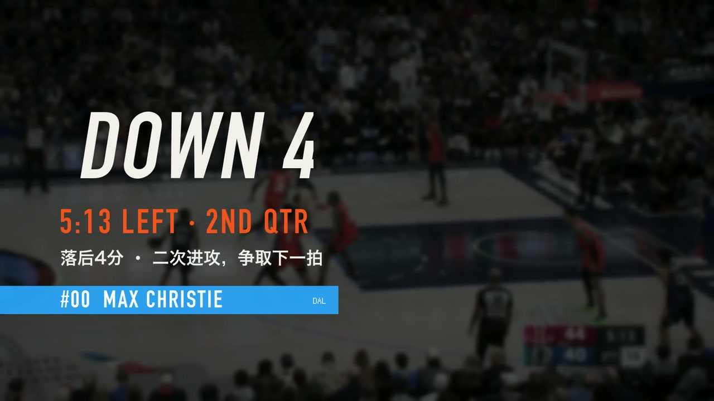
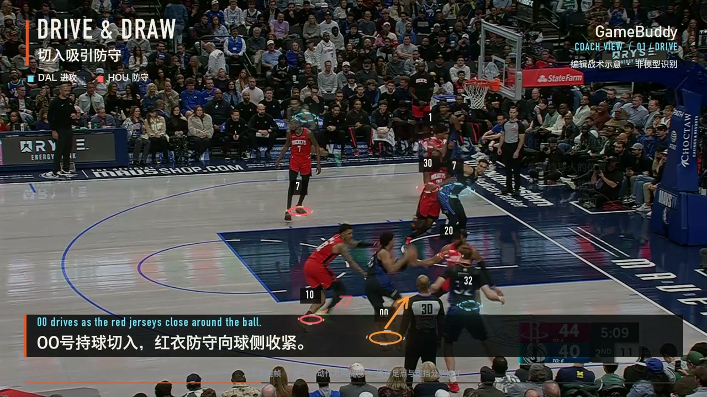
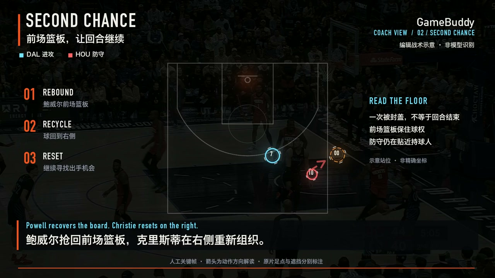
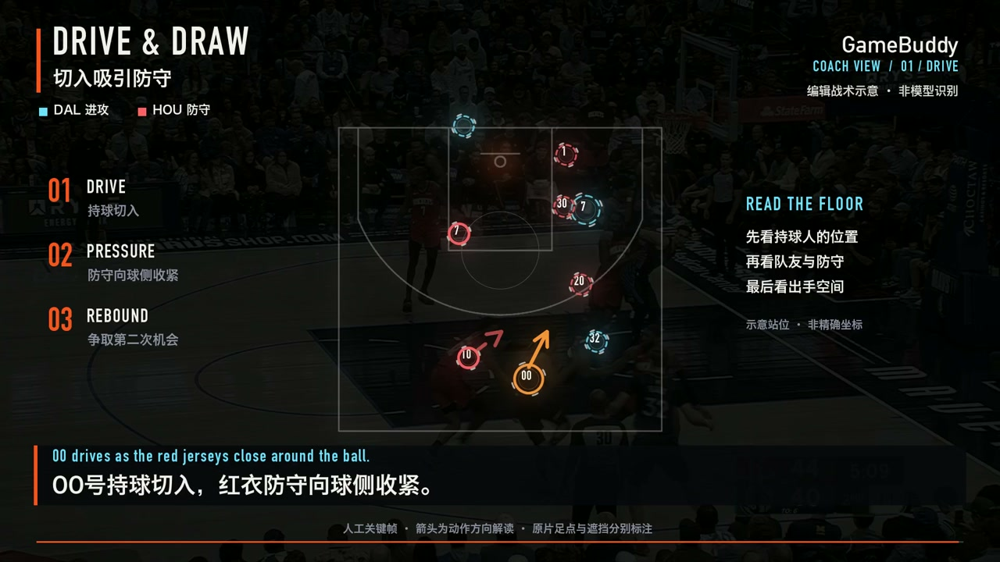
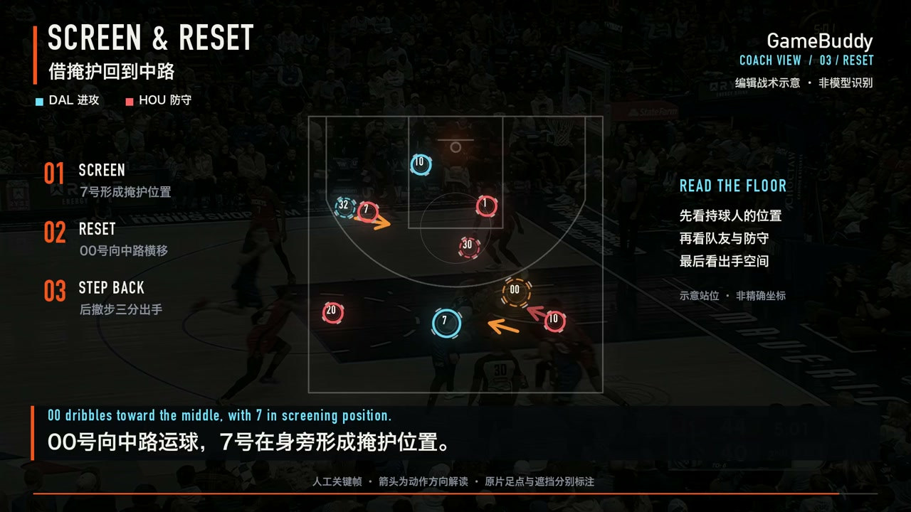
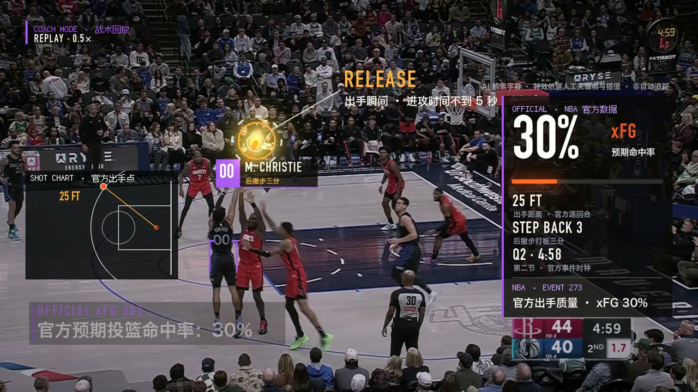
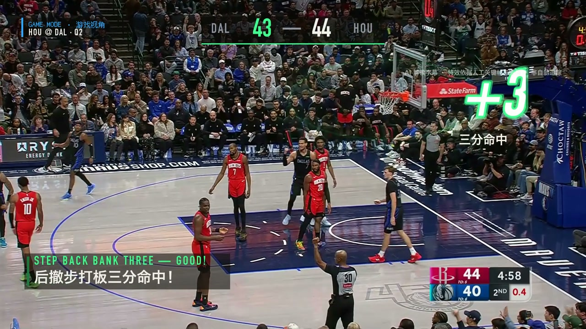
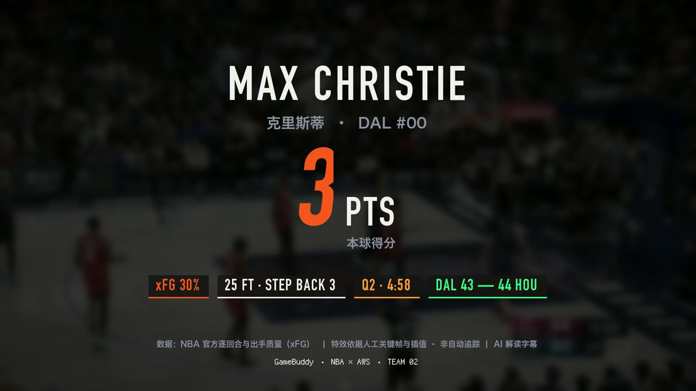

**10月11日 · 英文首尾v3：** 开场改为DOWN BY 4 / SECOND CHANCE，片尾以DOWN BY 1、43–44比分呼应，复用开场动效并整组滑出收黑，首尾全英文。55.055秒时间轴不变，独立母版已导出、完整解码及一次514项门禁通过。[最新画面与配音交接](docs/PPT英文画面与战术板精修-20261011.md)。

**10月11日 · 英文展示母版：** 55.055秒英文主文/中文小字版已导出，三处战术板站位与箭头逐一对照源帧精修，标记含外环均在场内；左上改为HOU @ DAL及2025-12-06 7:30 PM CT。完整解码、原时间轴核对与一次514项门禁通过；配音进程请使用最新英文母版。[画面与配音交接](docs/PPT英文画面与战术板精修-20261011.md)。

**10月11日 · 本地英文配音成片：** 已接入MOSS原创双人音色和新版TTS，55.055秒PPT版完整导出/解码，已接入最新英文画面及精修战术板，视频流与英文母版一致，画面无MOSS/AI制作说明小字；11项关键对白转写核对通过。源代码与实际范围见[本轮配音](docs/MOSS英文双人解说与PPT成片-20261011.md)。音色待用户试听，未部署云端、未实际打开PPT验收。

**10月11日 · PPT干净画面版：** 已独立导出55.055秒/3300帧新母版，去除配音供应商条和常驻制作说明、精简片尾，保留比赛数据与动画。完整解码及时间轴核对通过，现有514项门禁通过；新配音由另一进程接入。线上与正式提交片未改。[画面与配音交接](docs/PPT演示视频画面清理-20261011.md)。

**10月11日赛后核查：** 用户确认作品已提交并取得第四名。CloudFront主页与55秒成片可访问，公共API与历史任务可读取；参赛角色的权限边界当前拒绝AgentCore、Bedrock、SageMaker直接调用和资源管理读取。云端更新需主办方恢复权限；可继续本地优化。见[当前服务状态](docs/赛后服务可用性核查-20261011.md)。

**20:09公开入口已收敛：** 主域名与watch兼容地址均为玻璃页；`/product/`只有55秒考试成片像素页，练习创作/训练营/旧样片脚本已移除。旧实验页面云端不存在、访问403。当前以[公开路由](docs/公开路由收敛-20261010.md)为准，下方旧快照保留历史语境。

**20:01旧像素页：** 已独立放入现成55秒考试成片，练习创作保留；主路由/玻璃播放器/媒体标识未改。[适配与发布](docs/旧像素页考试成片快捷适配-20261010.md)。

**10月10日 · 正式55秒双人解说与主页：** 豆包v3接口已真实生成两位搭档语音，AgentCore请求`442ec313-1d48-444d-bada-a080467c9b7c`读稿/批准通过，最终55.055秒、3300帧、双音轨完整解码通过；58,674,692字节成片已上传正式CloudFront，根地址直接打开液态玻璃播放器，像素入口`/product/`保留。源码、真实边界和复现见[本轮说明](docs/正式55秒豆包双人解说与主页发布-20261010.md)。

**10月10日 · 55秒弗拉格风格复刻：** 按用户要求直接复用原出场/片尾函数和绿色命中动画，正式片扩为55.055秒，新增前场篮板与右侧重组的战术暂停。完整导出/解码、487项门禁及30项视觉/正式契约通过；本地新watch已接入，实际播放验收见[本轮说明](docs/正式视频55秒与弗拉格动画复刻-20261010.md)。正式新片Agent/RL/豆包仍分别联调。

# GameBuddy

[最终交付、AWS状态与重跑入口](docs/最终交付与重跑入口-20261010.md) · [正式播放器](https://deky02484tknr.cloudfront.net/)

### Your AI Basketball Buddy · 陪你看懂每一个回合

[Team02 · 公开作品亮点说明](https://deky02484tknr.cloudfront.net/readme)

**读懂数据，看清关键一拍，听懂篮球故事。**

GameBuddy 将 NBA 基础数据、高阶数据与深度赛场数据融合，结合强化学习数据球探、多模态智能体、关键回合可视化和个性化 AI 解说，把真实比赛片段转化为有画面依据、有数据支撑、可以交互探索的篮球解读。

我们的产品价值是：**让观众看完同一个回合后，多理解一件刚才没有注意到的事。** 从持球者的终结，到无球队友的站位、进攻篮板和防守回应，GameBuddy 引导观众重新发现一次进攻的过程。

*本文8幅配图均直接截自已确定的55.055秒克里斯蒂成片，时间标记为成片播放位置。画面保留原有来源说明；战术位置与箭头为编辑示意。训练后模型进入叙事与烧录的端到端能力已在弗拉格样片独立验收，各版本的实现范围分别记录。*

## 01 · 三层篮球数据融合：把事实、效率与深度背景讲成一个故事

**基础数据回答“贡献了什么”，高阶数据回答“效率怎样”，深度赛场数据提供“机会与角色还有什么值得关注”。** GameBuddy 将三层信息组织成相互关联的证据，为一个回合提供更完整的阅读角度。

- **基础数据**：得分、投篮、助攻、篮板、失误等官方比赛事实。
- **高阶数据**：由完整官方计数计算的 eFG、TS 等效率指标，保留公式和计算口径。
- **深度赛场数据**：官方出手 xFG，以及 Gravity、Leverage、Shot Difficulty 等机会质量、角色与影响力背景。

融合贯穿数据工具、模型训练、证据选择、叙事和成片呈现。已冻结的联合数据包包含 **1,993 条证据记录**，覆盖基础统计、派生效率和三类深度指标，并保存主体、单位、统计周期和来源。

在已验收的弗拉格 RL 成片中，**本场 34 分、eFG 54.00%、赛季无球外线引力 6.217** 实际进入同一次 Agent 解读与视频烧录；该次出手的官方 **xFG 51.0%** 独立展示。观众能够同时了解产量、效率、角色背景和具体出手机会，又能清楚区分它们各自的含义。

## 02 · 强化学习数据球探：训练模型学习如何使用篮球数据

**让模型学会找证据、选指标、调用工具，再把有依据的数据交给解读系统。** 我们基于 Qwen2.5-3B-Instruct 训练专用数据球探，通过监督微调与分组强化学习，使模型围绕篮球数据任务学习结构化工具使用和证据选择。

训练任务关注正确的球员、比赛、指标与统计范围，并对证据缺失和不成立的关系进行约束。模型输出短证据 ID 和受控关系，程序从来源记录中取得实际数字，避免自由生成数值。

这项工作包含 **640 次 SFT 样本训练、30 轮 RL 采样和 7 次真实权重更新**，并已部署到 SageMaker 实时端点。弗拉格产品任务真实调用训练后 3B 模型，选证结果进入 AgentCore 叙事和完整 MP4；本次选证耗时 **2.841 秒、2 次模型生成**，仅代表该次实测。

当前冻结小规模评测中，RL 相对 SFT 尚未显示额外增益。产品使用的是训练后的模型、语义校验与有限纠错组合；训练结果和产品调用效果分别记录。[训练结果](docs/RL三层联合训练结果-20261010.md) · [产品实测](docs/RL产品端到端联调验收-20261010.md)

## 03 · 视觉模型与数据模型协作：让画面理解和数据分析各有所长

**视觉模型看动作，数据球探选证据，叙事智能体把两者组织成观众能理解的解释。** GameBuddy 将篮球视频理解与结构化数据处理分工，既保留画面中的具体细节，也为解读补充可核对的背景。

视觉与叙事模型读取真实关键帧、关注动作先后并组织章节；3B 数据球探调用基础、高阶和深度数据工具，返回经过验证的证据。确定性程序承担数值复制、单位换算、来源检查和最终显示。

这种协作使解读可以从“发生了什么”进一步展开为“这段画面应该关注什么、有哪些数据值得一起看”。文本数据球探不生成球员位置，赛季统计也不被用来证明当前回合的动作原因。

## 04 · 统一证据语义：跨表关联，同时保留每个数字的准确含义

**数据可以一起使用，含义仍然保持清楚。** GameBuddy 为证据记录统一主体、比赛、事件、指标、单位、统计粒度、时期和来源，帮助模型与程序在同一套语义上工作。

单次出手、整场表现与赛季快照分别管理：xFG 是本次出手机会参考，eFG 是对应比赛范围的运动战投篮效率，引力与影响力使用各自来源的分数及赛季背景。百分比、计数和来源分值采用不同规则，不混用范围或单位。

来源信息使用引用表集中保存，模型优先接收与本次解读有关的少量证据，完整调用回执另行留存。这样既让叙事上下文聚焦，也让每一个显示值能够追溯到原始数据。

## 05 · 多轮工具调用与反馈修订：让解读经过可检查的过程

**读取画面、取得官方证据、提出故事、校验并修订，构成真实的智能体工作过程。** AgentCore 上的 Agent 实际执行读图、读取事件和校验工具，后续模型轮次基于工具返回继续组织章节。

校验器检查证据引用、视频时间、文字长度、统计口径和禁止的无依据断言，失败时将具体问题返回模型。工具步骤、模型轮次、用量和验证结果均与任务关联，观众与评委可以查看一段解读如何形成。

数据球探服务另有指标与来源校验及最多一次模型纠错。生成流程设置轮次、时间和输出预算，在有限资源内完成可检查的证据处理。[工具型 Agent](product/agent/story_agent.py)

## 06 · 关键回合视觉叙事：让观众知道该看谁、该看哪一拍

**把一次快速发生的攻防，展开为有重点、有节奏的观看体验。** GameBuddy 围绕回合故事组织定格、慢放、人物强调、方向示意、数据揭示和片尾收束，让观众逐步看清动作与回应。

正式克里斯蒂素材围绕“**封盖之后，再争一拍**”展开：首攻被封盖、鲍威尔抢回进攻篮板、克里斯蒂再次出手。原片约 **23.78 秒**的完整回合，在保留全部源帧顺序的基础上，加入三处战术暂停、人物出场、慢放回看和数据收束，形成已确定的 **55.055 秒**视觉解读片。

每一段视觉表达对应一个具体观察任务：先看持球与防守关系，再看回合如何延续，最后回看出手与官方数据。观众能在一次短体验中获得新的篮球理解。[55秒正式视觉成片](docs/正式视频55秒与弗拉格动画复刻-20261010.md)

## 07 · 关注进球之外的贡献：把无球队友与防守回应纳入故事

**将观看注意力扩展到回合中的其他参与者。** GameBuddy 的故事可以围绕持球处理，也可以围绕无球站位、防守起跳、追防、协防或进攻篮板展开。

同一回合从不同关注对象重新观看，可以帮助观众发现终结之前的动作。正式片中的进攻篮板有官方事件记录，人物强调与回放使这项贡献在画面中更容易被注意。

解读区分可见动作、官方统计与编辑判断。一个球投进了，仍可以观察防守施加了怎样的可见限制；某人的赛季数据较高，也不会直接转化为对本回合因果的判断。

## 08 · 转播画面与俯视示意切换：把空间关系变得容易阅读

**从真实镜头进入战术示意，再返回比赛画面，建立连续的空间理解。** 视觉组件用人物标记、双色攻防、方向箭头和镜头到俯视板的图形转场，帮助观众阅读站位及动作关系。

原画面提供动作和人物的视觉依据，俯视布局提供简化的阅读方式；字幕则指引当前应当关注的位置和对象。正式视觉版已复用这套转场与绘制组件。

俯视位置和箭头均明确标为编辑示意。脚部遮挡时使用身体括号，号码无法确认时保留匿名，避免把不确定位置画成精确事实；这些图形不代表自动追踪或官方逐帧坐标。

## 09 · 双时间轴：定格、慢放与回看之后，解释仍能对准动作

**原片时间用于定位证据，成片时间用于组织观看。** GameBuddy 将两条时间轴分开管理，明确记录正常播放、定格、倒带和慢放片段的对应关系。

观众在增强片里点击数据节点，系统通过时间映射找到相应动作；切回原片，也能回到正确的证据时刻。55秒版的冻结时间线中，原片 **13.5 秒**在首次顺序播放中对应成片约 **29.182 秒**，新增战术暂停的时间明确计入成片。

帧数、实际帧率与音频采样点共同决定剪辑边界。定格时间保持在同一源帧，慢放改变播放速度，新增解释时间不会被误写成真实比赛时间。[时间映射与联调](docs/正式素材前端与视觉联调-20261010.md)

## 10 · 分时数据揭示：在观众需要解释时，让数据出现

**让一项数字服务于当下的观看问题。** 数据卡片按章节和动作阶段呈现，既突出当前重点，也为真实比赛画面留出观看空间。

RL 样片分时展示基础表现、高阶效率和赛季深度背景，再用一段短叙事收束；官方出手 xFG 保持独立。正式视觉片将本球 **30% xFG** 与出手回看配合，动画终值和来源绑定到事件 273。

数值入场动画用于引导注意力，动画中间值属于视觉过渡。每项指标继续保留“本次出手”“本场赛后”或“赛季背景”标签，帮助观众在理解数字时同时理解其适用范围。

## 11 · AI 解说与个性化表达：让篮球故事听得懂

**将画面观察和经过核验的数据组织成解说文字，再通过语音合成补充观看体验。** GameBuddy 支持个性化解说；本次正式演示已使用男女搭档双人解说，配合画面、数据和回合节奏。

正式片由 AgentCore 真实读取并审核助手编辑的15段解说稿，再通过豆包 v3 接口、`seed-tts-2.0-expressive` 模型合成男女语音并对齐55.055秒时间线。主音轨降低原广播音量以突出对白，独立第二音轨保留原广播与程序提示音，成片永久标明“AI 双人解说 · 豆包语音”。

最终双人解说片已发布，并于19:47在正式CloudFront播放器自然播放到片尾。AgentCore本次负责读稿/审核，视觉场景仍是编辑制作；RL完整链路另在弗拉格样片验收。此前Polly派生作为独立AWS能力记录保留。[正式解说与发布证据](docs/正式55秒豆包双人解说与主页发布-20261010.md)

## 12 · 球员攻防档案与同口径比较：给回合补充可探索的背景

**让观众从一个镜头进入球员更完整的表现背景。** GameBuddy 提供进攻、防守、派生效率和赛季深度数据的分层档案，并支持来源一致的球员比较。

在已验收的弗拉格 RL 观看面板中，可以查看与同场阿门的 **18 项同口径比较**。例如 eFG 54.00% 与 46.67% 的差为 **7.33 个百分点**；公式、操作数、单位与统计范围均保留，零分母和缺失项明确显示不可计算。

这项能力由官方数据和确定性算术提供。所选对手是同场球员背景，未经核实不会标作当前回合的直接防守者；模型选证与程序比较也分别记录。[攻防画像与比较](docs/RL攻防球员画像与对比-20261010.md)

## 13 · 交互式证据回看：让观众亲自检查一条解读

**点击解释，回到画面；展开数字，看到来源。** GameBuddy 将关键节点、章节、真实帧和官方数据关联，让观众在观看过程中进一步探索。

原片与增强片可以切换，章节可以定位，数据和来源可以按需展开。观看区的关注点选择改变揭示内容与回看节点；生成任务的实际工具记录则提供另一条可核对的处理依据。

这种交互让普通球迷获得简洁的观看路径，也让更关注数据的观众继续查看细节。现有观看选择与创作 Agent 的输入分别管理，页面交互不会被包装成尚未完成的新成片生成控制。

## 14 · 沉浸式三态观赛：在观看与分析之间连续切换

**沉浸式、全场、半场三种桌面布局，共用一个播放器和当前观看位置。** GameBuddy 通过连续布局切换，让观众在欣赏比赛、查看战术示意和展开数据之间自然移动。

磨砂材质、可选动态玻璃、收放式控制和内容抽屉围绕视频组织，信息按需要出现。原片与烧录增强片使用各自的显示规则，增强片模式关闭重复的原片标注，保持画面清楚。

三态布局、媒体切换和来源记录已在既有样片完成本地浏览器核查；正式素材的原片及视觉编辑版亦已在新 watch 页面分别通过本地完整播放。

## 15 · 可复用视觉组件与完整成片：把一次展示沉淀为制作能力

**人物提示、战术场景、数据卡片和音频处理形成可复用的组件库。** 文字、光圈、短时标记、身体括号、箭头、图形转场、字幕及音效均有模块入口和调用约定，并与来源标注、时间线和资产哈希一起保存。

正式克里斯蒂视觉版复用了已有绘制与战术表达组件，同时为新视频重新建立帧锚点、人物标记与官方事件绑定。复用的是表达与渲染能力，新素材使用自己的事实和位置数据。

输出为带永久可视化的完整 MP4，可独立于网页观看。视觉编辑版完整保留原回合，新增定格和额外回放；自动 Agent 成片按自己的原时间轴契约输出。两种制作方式分别验收，组件复用本身不被记作 Agent 自动执行。[视觉组件库](product/broadcast-fx/README.md)

## 16 · AWS 托管协同与可验证工程：让创新有真实交付基础

**13 项 AWS 业务服务围绕真实职责协同，支撑从智能体推理到成片交付的工程能力。** AgentCore 与 Bedrock 承载智能体和多模态解读，SageMaker 承载数据球探训练及在线推理；Lambda、SQS、DynamoDB 管理异步任务和状态，S3、CloudFront 保存与发布作品；EventBridge、Step Functions、CloudWatch 支撑独立交付验证和运行观测，Polly、Rekognition 提供可选语音与场景辅助。

主链基础设施由 AWS CDK 定义，SageMaker 训练与端点另有 SDK 部署脚本。任务有真实状态、原始调用记录和明确产物，模型或可选派生能力失败时保留对应回执；已完成成片与后续派生结果分别管理。

工程质量落实在依赖版本固定、共享数据契约、源码与媒体分离、公开资产白名单、权限边界、GitHub CI 和完整媒体检查上。正式视觉联调版本已记录 **487 项统一离线检查通过**，另有真实全片解码和浏览器自然片尾证据；运行、内容与媒体分别验证。

输入与输出使用 SHA-256 绑定，模型训练来源和真实工具调用可追溯，缓存或历史成果明确标识。代码规范、服务协同与证据记录共同支撑产品的可检查性，而非单靠功能数量或资源数量说明完成度。[工程质量机制](docs/工程质量与快速迭代-20261010.md)

## 工程质量与交付依据

**提交前工程质量核对：** 19:42一次完整离线门禁504项通过；已提交fa10073的GitHub CI成功。已完成代码规范、AWS实际使用与最终联调边界见[质量清单](docs/提交前代码与AWS质量核对-20261010.md)。本地检查包含并行未提交代码，不替最终发布验收。
