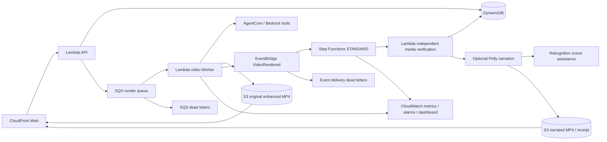

# AWS 托管成片交付闭环 · 2026-10-10

本轮按“原生托管、服务深度、代码可重跑”补齐实际业务环节。正式账号 `555726205424`，`nba` / `us-east-1`，仍复用 `BroadcastCodeTeam02Readiness20261006`；不执行 bootstrap。前端由队友维护，原 AgentCore 推理、原增强成片与任务完成状态保留。

## 成片和交付各负其责



图中语音和标签同属一个可选 Lambda：实际先核对原成片，再调用场景标签、分段合成语音和渲染。任何可选媒体失败只返回不可用，仍可交付原验证成片；不会重新跑模型、改原任务为失败或覆盖原 MP4。

## 部署和真实核验

- CDK 主栈已增量部署：独立媒体缓存策略、一个事件总线、标准工作流、两项交付 Lambda、六个告警与一个仪表盘，全部六个自建角色带赛事边界。最新源码门禁与实际运行以相应证据为准。
- [原成片独立验证与缺失任务负例](../product/evidence/native-delivery-verifier-20261010.json)：真实 SHA-256、1280×900/H.264/AAC/全解码一致；缺失任务正确 FAILED，未创建任务或执行配音。正常返回必须 `verified:true`，不是 Lambda HTTP200 即通过。
- [正式缓存迁移和字节验证](../product/evidence/native-cache-publication-20261010.json)：33个对象服务端 SHA-256/长度/缓存政策核对；28个服务端 CopyObject、0个本地重传、5个复用。两个相同 Range GET 206且字节相等，第二次 Hit/Age=1。首个慢上传中止与一次SSL重试证据保留。
- [正例实际执行](../product/evidence/native-delivery-workflow-20261010.json)：EventBridge真实触发SFN，原片verified:true、Rekognition7标签真实返回；首Polly派生CalledProcessError。FFmpeg4.1兼容修复已部署，但15:00重放响应超时、尚未确认新执行，新派生/成功幂等复验未完成，下一步见[接续快照](Agent交接-20261010-1506.md)。

## 服务如何与评分要求对应

|服务|新业务作用|专业使用与边界|
|---|---|---|
|EventBridge|生成完成后的领域事件 `broadcastcode.product / VideoRendered`|只传 jobId；检查PutEvents失败条目；限定总线权限；15分钟事件年龄、两次重试、独立目标DLQ。原片已持久化后才发，不因发布失败失去成片。|
|Step Functions|独立交付验收编排|STANDARD执行历史、Choice检查verified、存储瞬态失败有一次等待复查、明确拒收终态；可选语音失败不撤销原成片。不是把已有SQS调度改成长同步API。|
|Polly|阶段同步的短语音解读|复制已验证短句，SSML转义、Zhiyu standard、真实测量每段时长；官方xFG不早于revealAt，过长回退、不截音；永久AI声明。|
|Rekognition|真实注册帧的场景辅助标签|DetectLabels及置信度可查；不作为球员身份、追踪或篮球内容准确性认证，失败独立保留。|
|CloudWatch|可诊断的任务/事件/交付结果|EMF低基数Service维度，不把jobId作为指标维度；6个失败/死信/积压告警与仪表盘，不额外向外发送消息。Worker业务指标在新任务实际运行后才会有样本。|
|CloudFront / S3|交付可缓存的不可变成片|独立输出/原片/帧行为，minTTL=0尊重no-store；job视频/分析一年immutable、原片帧一天；API/故事表实时。服务端复制仅限实际checksum和JSON事实相同并加ETag前置条件。|
|Lambda / DynamoDB / IAM / CDK|验证逻辑、状态与权限|复用核准FFmpeg Layer和锁定SDK；完成任务条件更新独立回执；新验证/语音角色按对象前缀授权；源片哈希、官方事件与Runtime身份必须匹配。|

SageMaker训练仍由独立会话负责；本轮不把尚未验收的新3B当作主链已启用，不更改其模型发布。AWS服务数、资源数和测试数都不是官方分值。

## 重跑与恢复

从 `product/` 构建和部署同一栈；使用锁定依赖与 `python3 product/scripts/check.py --full`。`product/scripts/build.py` 同时打包 agent、worker、delivery，后者复用同版本 story_contract 和SDK。角色权限边界由 `cdk.json` 保证。

新story任务正常完成后由Worker发送事件。历史完成任务可使用 [恢复工具](../product/scripts/replay_delivery.py)，先默认只读预检，再加 `--execute`；它只发交付事件，不重新推理、不重新入队。正式执行需要正确身份、已有completed/story任务、对应CloudFront路径与哈希；未知发布结果不可盲重放。

```sh
readiness-lab/.venv/bin/python product/scripts/replay_delivery.py --job-id 3526ae13a69b42c082b2fe4f0bacfa67
readiness-lab/.venv/bin/python product/scripts/replay_delivery.py --job-id 3526ae13a69b42c082b2fe4f0bacfa67 --execute --receipt-file product/build/delivery-recovery.json
```

正式新素材仍需注册真实视频、事件与来源后走主生成链路，不能直接套用样片事实。机器评测完整官方schema仍未取得，内部 `product-story-v1` 和本工作流不是官方协议。

## 前端接入边界

现有 `GET /api/jobs/<id>` 可读独立 `deliveryVerification`；完成任务不保证可选配音已完成。待验证为真后，读取同job下 `narration.json`（no-store）。仅在 `available:true`、版本/原hash匹配时把 `videoUrl` 提供为可选语音版本，默认原片仍使用原videoUrl。可显示真实scene标签来源，但不称自动球员追踪。详细契约见[交付验证器](../product/delivery/README.md)与[托管媒体](../product/delivery/README-native-media.md)。

最新固定门禁：[385项质量快照](../product/evidence/native-quality-20261010.json)。新[浏览器完整播放](../product/evidence/native-cache-browser-20261010.json)首载1.987秒、总墙钟53.658秒，仍6次中途缓冲；[观测实测](../product/evidence/native-observability-20261010.json)证明告警/看板与受控失败指标。此快照没有新的成功配音，前端不得切到未验收派生成片。
