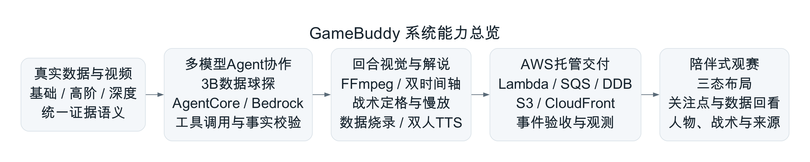
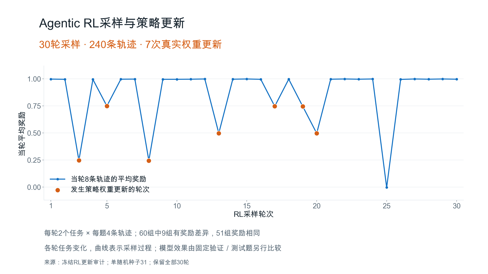
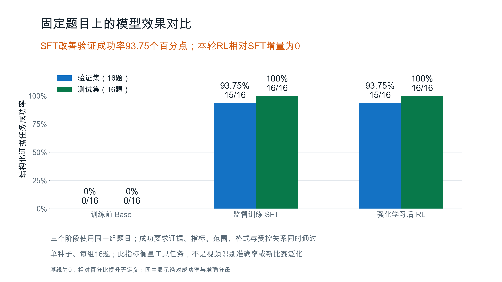
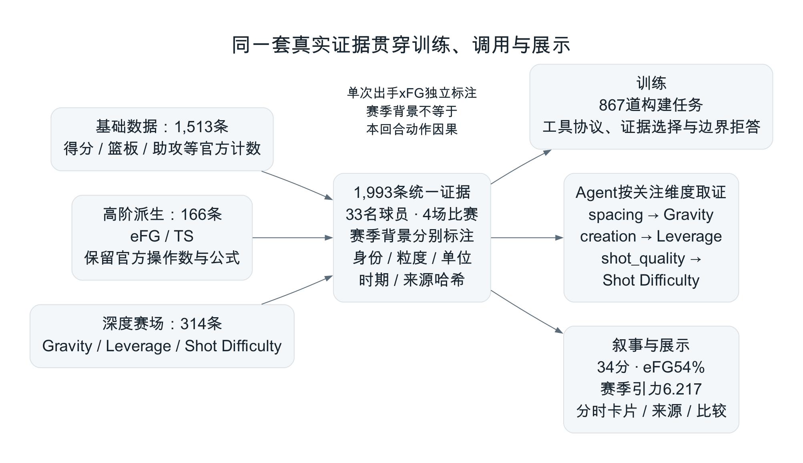
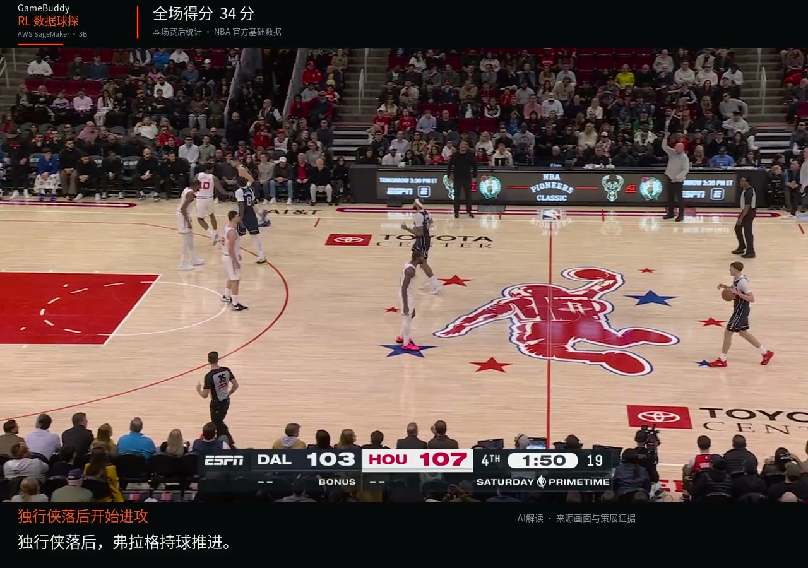
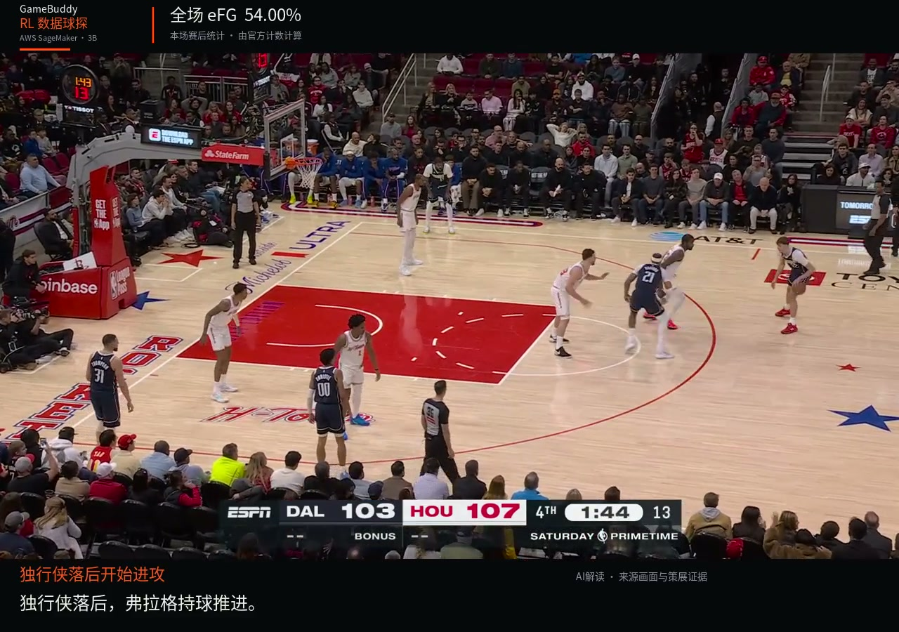
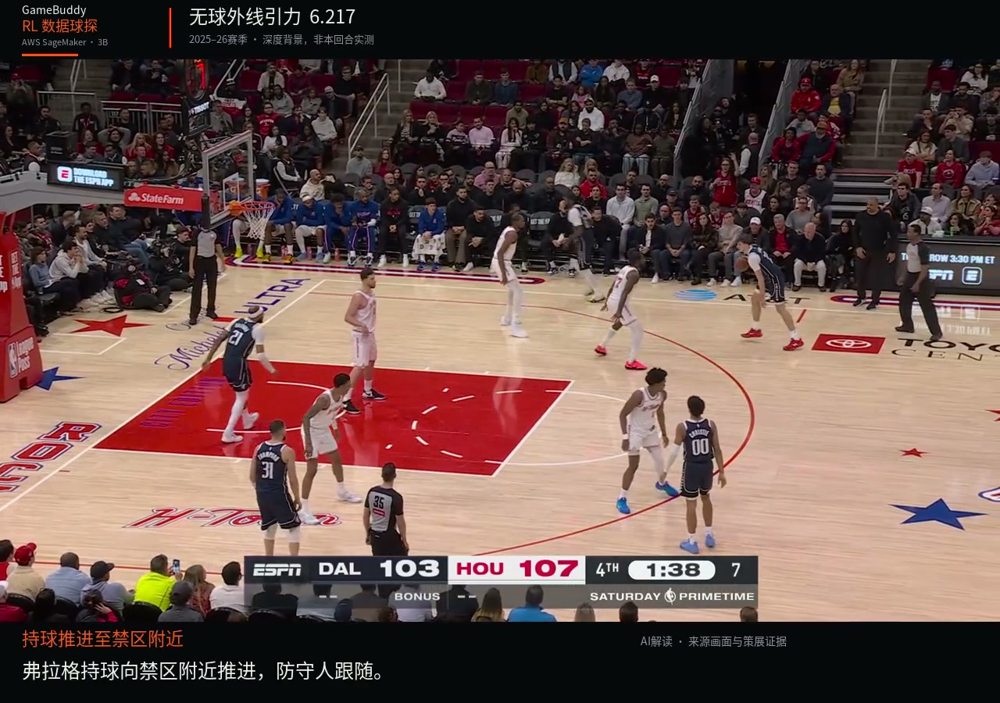

# GameBuddy：技术核心创新与答辩素材

整理日期：2026-10-11。本文用于制作技术答辩PPT，依据比赛期间实际部署、冻结训练结果和已发布作品整理。正式55秒作品与自动RL样片分别验收，架构图表达整个项目的能力与职责。

## 五条核心主线

|主线|推荐PPT标题|核心技术主张|
|---|---|---|
|整体架构|数据证据驱动的多模型观赛架构|用数据球探处理结构化证据，用视觉与叙事Agent解释画面，再通过受控渲染和托管交付生成可观看的作品。|
|Agentic RL|面向工具调用与证据选择的Agentic RL|将“查什么、选什么、如何关联、何时拒答”转化为可训练的策略任务，完成3B模型训练、端点服务和产品接线。|
|AWS服务协同|AWS支撑的异步生成与可验证交付|13项业务服务围绕真实职责协同；重点是推理、任务调度、持久化、交付验证与观测之间的配合。|
|数据为中心|三层真实数据贯穿训练、取证与展示|同一套证据语义服务训练环境、Agent接口和观众展示，保持主体、统计范围、单位与来源一致。|
|陪伴式体验|围绕回合阅读的陪伴式交互与视觉叙事|三态布局、关注点、证据回看、双人解说与战术动效，帮助观众逐步看清一个回合。|

可用于开场的概括：

> GameBuddy构建了一个由真实篮球证据驱动的观赛助手：专门训练的数据球探选择可信背景，视觉Agent组织回合解释，AWS负责生成与交付，最终通过可视化和解说让观众理解每一个关键动作。

## 第1页：整体技术架构

**一句话主张：结构化数据策略、视觉叙事和确定性渲染各有职责，共同形成可追溯的观赛解读。**

建议主图：[整体能力架构PNG](figures/03-technical-architecture-dark.png) / [可编辑SVG](figures/03-technical-architecture-dark.svg)。白底版本文件名为`-light`。

可直接放进PPT的要点：

- **证据输入层**：真实比赛视频，官方基础统计、由官方计数派生的高阶效率、深度赛场指标；统一素材、球员和事件身份。
- **模型协作层**：Qwen2.5-3B数据球探通过SageMaker选证；AgentCore上的Bedrock视觉与叙事模型执行读图、查证、校验和反馈修订。
- **内容制作层**：FFmpeg完成数据烧录与完整MP4；回合视觉组件承担战术定格、俯视示意、慢放、人物强调及音画时间对齐。
- **交付与体验层**：异步队列和状态表支撑生成；S3、CloudFront提供作品；播放器提供布局切换、章节回看、数据与来源探索。

讲解重点：模型负责选择证据和形成解释，确定性程序负责复制数值、校验单位、约束时序以及生成最终画面。这样既利用模型的表达能力，也让显示出来的事实保持可核对。

### 两条已验证的实现路径

|路径|实际执行|对应成果|
|---|---|---|
|自动RL样片|Lambda API→SQS→Worker；真实3B端点选证；AgentCore多轮视觉/叙事；FFmpeg三层卡片烧录；独立媒体验证|弗拉格注册样片，约21.548秒；真实生成任务整链61.38秒，RL取证2.841秒、2次生成，均为该次实测。|
|正式55秒作品|正式素材的编辑视觉与时间线；AgentCore读取并审核15段稿件；豆包TTS双人语音；混音与双音轨；S3/CloudFront发布|55.055秒、3300帧、1920×1080；最终文件58,674,692字节，正式播放器自然播放至片尾。|

详细路径图：[PNG](figures/05-verified-system-paths-light.png) / [SVG](figures/05-verified-system-paths-light.svg)。

答辩用语：**“我们验证了数据球探进入自动叙事和烧录的完整路径，同时用55秒正式作品展示了经过打磨的视觉叙事与双人解说。”** 正式55秒作品的AgentCore调用承担稿件审核，其视觉场景属于编辑制作；不把旧样片的RL调用记到正式片上。

依据：[RL端到端验收](../../RL产品端到端联调验收-20261010.md)、[55秒双人解说与发布](../../正式55秒豆包双人解说与主页发布-20261010.md)、[基础设施](../../../product/app.js)。

## 第2页：Agentic RL训练与效果

**一句话主张：我们训练了一个专门处理篮球证据的工具策略，让数据球探学习如何取证、选择和拒绝不成立的结论。**

### 方法要点

|部分|本项目实现|
|---|---|
|模型与资源|Qwen2.5-3B-Instruct；正式账号SageMaker单台`ml.g5.xlarge`，NVIDIA A10G。|
|训练方式|4-bit NF4 QLoRA，LoRA rank16；先进行监督训练，再进行分组归一化的on-policy策略梯度实验。|
|Agent环境|模型发出工具动作，环境返回真实证据，模型继续行动并提交短证据ID和受控关系；最长3轮，工具调用有预算。|
|动作监督|只优化助手动作/回答token，工具返回作为环境观察；模型不自由生成展示数值。|
|奖励设计|事实匹配30%、证据来源25%、覆盖20%、关系15%、格式10%；工具调用成本每次扣0.002，关键语义错误直接拒收。|
|训练规模|867道构建任务；实际640次SFT样本优化，涉及291条不同训练题；30轮RL采样、240条轨迹、7次真实权重更新。|

方法名称可写为：**“QLoRA SFT + Agentic RL for Evidence Selection”**。实现为分组归一化、每组单次on-policy策略更新，无reference KL；不标为完整clipped PPO或标准多轮PPO训练。

### 训练过程图

可直接插入：[深色PNG](figures/01-rl-training-curve-dark.png) / [白底PNG](figures/01-rl-training-curve-light.png) / [SVG](figures/01-rl-training-curve-light.svg)。原始绘图数值：[30轮CSV](rl-training-curve.csv)。

图中保留全部30轮，橙色点标出实际更新权重的7轮。60个采样组中9组有奖励差异，51组奖励相同；同奖励组缺少组内相对学习信号。各轮任务变化，奖励起伏是采样过程记录，不能直接当作固定验证集的收敛曲线。

完整SFT损失序列未保存在当前本地资料中；10月11日读取对应S3日志被赛事权限边界拒绝，因此本素材不补画SFT loss曲线。现有曲线来自已冻结的逐轮RL更新审计。

### 同题效果对比：原始数据表

|阶段|验证集成功|验证成功率|测试集成功|测试成功率|格式合格率|
|---|---:|---:|---:|---:|---:|
|训练前Base|0/16|0%|0/16|0%|0%|
|监督训练SFT|15/16|93.75%|16/16|100%|100%|
|RL后|15/16|93.75%|16/16|100%|100%|

可直接插入：[深色PNG](figures/02-model-comparison-dark.png) / [白底PNG](figures/02-model-comparison-light.png) / [SVG](figures/02-model-comparison-light.svg)。六行原始汇总：[CSV](model-comparison.csv)。

建议讲解：

1. **训练让模型适应本项目的工具协议与证据选择任务。** SFT较Base改善验证成功率93.75个百分点、测试成功率100个百分点。基线为0，相对百分比提升无定义。
2. **RL真实执行，但本轮未观察到额外效果提升。** SFT和RL在固定题目上的结果相同，RL增量为0个百分点。
3. **模型能力与系统可用性分开验证。** 原始验证仍有1例eFG/TS语义混淆，零关键错误的裸模型发布门槛未通过。后续部署的是用户授权的RL权重、严格程序校验及最多一次纠错的组合。

### 系统落地证据，作为单独的指标

|系统验收|实际结果|能说明什么|
|---|---|---|
|两样片×三种深度关注方向|6/6最终通过；5例直接通过，1例一次纠错后通过|已知注册素材上的模型、工具和语义护栏能协同完成三层选证。|
|RL进入视频链路|一次真实选证2.841秒、2次生成；三条证据进入Agent叙事和完整MP4|训练模型已实际进入产品，而非仅显示训练徽标。|

这两类系统验收不是新的模型盲测，不与16题评测混成一个准确率。

**主要限制**：单随机种子31，每个固定评测组只有16题；指标是结构化工具任务成功率。四场比赛都用于开发，不能据此声明新比赛泛化、视频识别准确率或统计显著性。

**Q&A备用：下一步实验**。从训练集构建“数字相同但指标不同”的对比难题，改善组内奖励区分；增加新的球员/比赛留出评测及多个随机种子，再检验RL增量。失败验证题不直接回灌训练。本轮未启动这些实验。

依据：[训练报告](../../../product/rl/results/evidence-v1/training-report.json)、[冻结效果比较](../../../product/rl/results/evidence-v1/comparison.json)、[实际RL更新审计](../../../product/rl/results/evidence-v1/rl-update-audit-20261010.json)、[服务交付](../../RL服务交付-20261010.md)、[训练器](../../../product/rl/train_evidence.py)。

## 第3页：AWS服务协同与落地效果

**一句话主张：AWS分别承接模型运行、异步生成、状态管理、作品交付和独立验收，使技术能力形成可部署、可观测的产品路径。**

### 完整业务服务清单

按本项目业务能力口径共13项：AgentCore与Bedrock分计，CloudWatch日志与指标合计；CloudFront Functions属于CloudFront能力。CDK和身份/部署支撑项另列。

|AWS服务|实际承担的职责|对技术落地的帮助及证据|
|---|---|---|
|Amazon Bedrock AgentCore|托管工具型Agent运行时；实际多轮工具调用及正式稿件读取/审核|将读图、取证、校验和审核组织为有真实调用回执的服务。|
|Amazon Bedrock|调用Claude Sonnet 4.6执行视觉理解、章节叙事与稿件审核|模型表达与项目工具约束共同工作，避免仅在页面显示预设回答。|
|Amazon SageMaker|3B模型GPU训练、CPU打包及实时端点推理|单台A10G完成QLoRA/SFT/RL；训练权重有可核验身份，Worker可调用指定端点。|
|AWS Lambda|API、视频Worker、独立媒体验证与可选语音处理|使用Function URL和受控Worker；计算职责分开，已实现异步任务及媒体处理。|
|Amazon SQS|渲染队列、重试及死信队列|把长生成过程从网页请求解耦；Worker单并发与批次1控制资源和推理预算。|
|Amazon DynamoDB|任务状态、预算、输入输出身份及验收回执|观众可查询处理阶段；“生成完成”和“独立交付验证”分别保存。|
|Amazon S3|视频、帧、数据快照、模型相关产物及原始回执存储|作品与大回执持久化；SHA-256和来源记录便于重跑、核对和缓存复用。|
|Amazon CloudFront|HTTPS网页与视频交付，OAC连接私有S3与Lambda源|同源目录支撑播放器和玻璃取样；媒体Range206与缓存命中均有真实记录。|
|Amazon EventBridge|成片保存后发布`VideoRendered`完成事件|推理/渲染与后续验收解耦；事件重试、有效期及目标死信队列独立控制。|
|AWS Step Functions|STANDARD独立交付验收工作流|根据媒体验证结果选择通过、等待复核或拒收；可选派生失败保留原成片。|
|Amazon CloudWatch|日志、业务指标、告警与运行看板|有6项失败、死信及积压告警；原始任务、事件和媒体问题可以分别定位。|
|Amazon Polly|已实测的可选AWS原生章节语音派生|根据实际语音时长放入章节窗口，提供额外语音版本；正式最终双人语音使用豆包。|
|Amazon Rekognition|真实注册帧的场景辅助标签|独立标签调用已返回结果；用于场景辅助，不承担球员识别或逐帧追踪。|

### 工程与身份支撑

|技术|项目作用|
|---|---|
|AWS CDK|主链基础设施定义与增量部署；离线模板核验50个资源和6个带赛事边界的自建角色。SageMaker训练/端点另有SDK脚本。|
|AWS CloudFormation|承接CDK Stack的资源创建与更新。|
|AWS IAM|工作负载角色、赛事permissions boundary、指定端点调用权限和源访问控制。|
|AWS STS|操作前核对正式账号和参赛角色身份。|

### 最值得展示的4个“有效协同”例子

1. **异步生成**：API把任务送入SQS，Worker在后台完成Agent推理与FFmpeg；DynamoDB提供可查询状态。一次RL样片整链实测61.38秒，网页请求无需同步等待整段处理。
2. **有限推理上下文**：完整原始RL回执16,580字节另存S3；约46KB展示数据单独组织，仅3条选证及少量对比进入叙事，不传完整约160KB双人上下文。体现按需取证与上下文管理。
3. **减少重复媒体传输**：一轮33对象的缓存迁移中，28个对象使用服务端CopyObject，5个复用、0个本地重传；重复Range请求字节一致，第二次已有Hit/Age记录。体现已有成果复用，而非重复推理、下载、上传。
4. **独立交付质量**：S3保存完成成片后发EventBridge事件，Step Functions再检查来源、哈希、时长、音轨和完整解码；可选配音失败不会撤销原作品。

这些是架构机制和具体实测，不是对成本、整体延迟或可靠性的受控前后对比，不宣称未经测量的百分比收益。

适合讲解的结论：**“我们把AWS服务放在明确的业务环节，用异步调度、按需取证、不可变产物复用和独立交付验证，让AI能力形成真实作品。”**

依据：[CDK源码](../../../product/app.js)、[托管交付闭环](../../AWS托管交付闭环-20261010.md)、[提交前质量清单](../../提交前代码与AWS质量核对-20261010.md)、[RL产品验收](../../RL产品端到端联调验收-20261010.md)。这里描述比赛期间实际实现与验收；10月11日部分云调用已受赛后权限边界限制，演示使用已保存产物。

## 第4页：数据为中心的设计

**一句话主张：基础、高阶和深度赛场数据在统一语义中融合，并贯穿模型训练、Agent取证和观众展示。**

插图：[深色PNG](figures/04-data-centric-design-dark.png) / [白底PNG](figures/04-data-centric-design-light.png) / [SVG](figures/04-data-centric-design-light.svg)。

|数据维度|证据数|如何理解|实现口径|
|---|---:|---|---|
|基础数据|1,513|球员贡献了什么|官方得分、篮板、助攻、投篮计数等。|
|高阶派生|166|贡献的效率怎样|eFG、TS由官方操作数确定性计算，保留公式。|
|深度赛场|314|机会质量、角色和影响力背景|Gravity90条、Leverage160条、Shot Difficulty64条；单次官方出手xFG另外保存。|
|合计|1,993|不同层级的证据形成关联|当前联合包覆盖33名球员、4场选定比赛及赛季背景，时期和粒度分别标注。|

### 数据贯穿三处技术环节

- **训练环节**：统一记录生成867道工具任务，既有基础/效率查询、三层联合选证，也有缺失、时间、事件粒度和因果边界任务。训练奖励从同一套证据和语义计算。
- **Agent环节**：`spacing`选择Gravity，`creation`选择Leverage，`shot_quality`选择Shot Difficulty；返回短ID，经程序核验后再读取实际数值。同一个回合可按不同数据关注方向组织背景。
- **呈现环节**：三层数据采用分时卡片、章节叙事、球员档案及同口径比较；观众能看到结论使用了哪条证据，而非只看到一句模型评价。

### 一个已经完成的例子

弗拉格样片实际同时使用**本场34分、eFG54.00%、赛季无球外线引力6.217**；三条证据进入真实Agent叙事并永久烧录。该次出手的官方xFG51.0%独立展示。球员比较有18项同口径指标，例如54.00%与46.67%相差7.33个百分点，由确定性算术计算。

下面三幅画面直接从该次已验收RL成片提取，适合在数据页并排展示。它们属于弗拉格自动样片。

|基础：本场34分|高阶：eFG54.00%|深度：赛季引力6.217|
|---|---|---|
||||

正式克里斯蒂作品则用**本球3分、25英尺出手、event273、xFG30%及43–44比分**对齐回放与解说。这个数字集合属于正式回合，不复用弗拉格的统计。

技术上应强调：

1. **跨表关联保留语义**：主体、比赛/事件、指标、单位、统计粒度、时期、来源哈希共同决定一条证据的含义。
2. **模型选择与数字生成分工**：模型选ID和关系，程序从可信记录复制数字；模型不能把自己的估计写成官方数据。
3. **分清背景与动作依据**：本场赛后统计和赛季深度快照补充背景；真实帧提供动作依据。赛季引力不直接证明某一回合的因果关系。

个性化的具体范围：数据球探接口支持3种关注维度，服务验收覆盖两样片×三方向；自动Worker当前固定使用`spacing`。观看偏好已用于提醒与内容过滤，尚未作为自由提问规划或自动重新生成成片的统一输入。

依据：[联合证据包](../../../product/rl/data/evidence/store.json)、[任务与奖励环境](../../../product/rl/evidence_env.py)、[关注维度接口](../../../product/rl/product_bridge.py)、[产品桥接](../../../product/worker/rl_integration.py)。

## 第5页：陪伴式观赛与视觉叙事

**一句话主张：把观众理解一个回合的过程落实为连续的观看、解释与探索体验。**

建议页面主视觉用正式片的[官方数据回放](visuals/formal-shot-quality.jpg)，辅图用[战术俯视](visuals/formal-court.jpg)与[命中动画](visuals/formal-basket.jpg)。画面来源是已确定的55秒视觉母版；当天另有PPT英文画面/配音版本在独立制作。

可直接放进PPT的要点：

- **连续的观赛空间**：沉浸式、全场、半场共用播放器和观看位置，在欣赏比赛与查看战术之间切换。
- **观众偏好适配**：关注球员、熟悉程度、观看目的等偏好可以保存；提示与事件列表按已有证据适配，来源不足时保持缺失。
- **按回合组织视觉解释**：人物提示与攻防双色引导注意力；真实镜头进入俯视编辑示意，再返回原画；三处战术暂停解释切入、防守、前场篮板与重组。
- **数据出现有节奏**：慢放、出手定格、官方点位和xFG面板同步；人物开场、绿色命中反馈、比分更新及片尾数据完成视觉叙事。
- **陪伴式解说**：正式演示使用男女双人搭档。现场情绪与分析解释由不同声线承接，15段稿件按55.055秒时间窗口对齐；独立第二音轨保留原广播与提示音。

技术亮点包括：

|实现|对观众的作用|
|---|---|
|原片/成片双时间轴|新增定格、倒带和慢放后，数据节点仍能对应正确的源动作。55秒版原片13.5秒的首次播放位置约为29.182秒。|
|liquidGL/WebGPU玻璃取样及延迟加载|在保留比赛画面的同时承载控制与解释信息；本地玻璃开/关各6秒样本约60FPS、零丢帧，仅覆盖该次设备/工况。|
|可复用动效与视觉组件|人物标签、标记、箭头、相机到战术板转场、命中波纹、弹字、字幕和音效可配置复用。|
|完整MP4与独立播放器模式|增强内容永久烧录；原片和增强片采用不同解释图层规则，避免叠加重复字幕。|
|实际音频时长测量与混音|对白在原广播上清楚出现；超过窗口不截断词句，按真实时间线调整。|

讲解用语：**“陪伴感通过观看连续性、关注点适配、解释时机和解说搭档来实现；每种交互都围绕观众当前正在看的动作。”**

真实范围：战术坐标与箭头属于编辑示意；最终正式片的稿件由助手编辑并经AgentCore审核。已实现的偏好和取证接口可以展示，自动根据任意偏好重新生成全部视频/解说应列为后续扩展。

依据：[三态前端联调](../../前端合并与联调-20261010.md)、[55秒视觉组件与成片](../../正式视频55秒与弗拉格动画复刻-20261010.md)、[双人解说](../../正式55秒豆包双人解说与主页发布-20261010.md)、[偏好实现测试](../../../product/watch/tests/preferences.test.js)。

## 推荐的答辩组织

先讲架构与职责，再用RL方法/同题结果证明做过训练；接着用4个AWS协同例子说明落地；数据页展示同一套证据如何穿过全系统；最后播放55秒作品，用画面和交互展示体验。

主讲页保持5条主线。RL过程曲线和完整AWS表可作为补充页；如果RL部分拆为方法与结果两页，其他主线顺序保持不变。

|可以使用的表述|相应准确范围|
|---|---|
|训练后数据策略在固定测试上16/16通过|16道结构化证据任务，单随机种子。|
|执行真实Agentic RL训练并部署RL权重|30轮采样、7次实际更新；当前RL相对SFT增量为0。|
|三层数据贯穿训练、Agent与展示|已验收RL样片使用三层证据；正式片的数据与调用范围单独记录。|
|13项AWS服务有效协同|整个项目能力口径，包含可选原生语音/标签；不表示最终55秒作品逐一调用了所有服务。|
|可视化与个性化观赛|已有偏好、界面与取证focus；全自动个性化成片的端到端联动待扩展。|

## 素材文件与复现

`figures/`提供深色、白底PNG与SVG；SVG保留文字，Graphviz图另有DOT源码。两张统计图PNG为2880×1620，适合直接插入PPT。CSV可以在PowerPoint/Excel中重新制作原生图表。

绘图入口：`python3 docs/ppt-materials/20261011/build_materials.py`，使用Matplotlib和Graphviz。本轮绘图验证六份逐题文件的固定ID、成功计数、30轮完整记录和7次更新次数；来源哈希见[图表清单](figure-manifest.json)。

此文及素材仅用于本地答辩准备，不执行新的训练、推理或云端部署。正式作品链接、运行状态和历史验收以对应交付记录为准。
