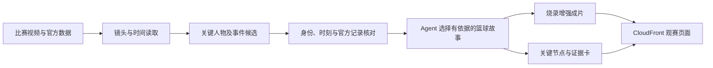

# 上交 AI for Sports：研究借鉴与交流建议

**用户方向更新（2026-10-06）：交流重点是黑客松产品的创新体验、篮球洞察与展示方式。最新建议见[产品创新与学长交流提纲](产品创新与学长交流提纲.md)。本文保留模型和代码核查作为技术备选，不再将最小推理流程与模型复用作为首要交流目标。**

核查日期：2026-10-06。依据饶珈源学长的[主页](https://jyrao.github.io/)、作者论文、项目页与公开仓库，以及本项目已核准的比赛要求。用户表示曾在该组实习、学长曾指导自己；目前尚未取得该组内部代码或作者对复用范围的答复。本轮为公开资料研究，没有联系作者，也没有安装或运行研究仓库、下载模型权重或新增云资源。

## 1. 结论：值得联系，交流重点应落在篮球感知与证据对齐

这个联系与比赛有直接技术关联。学长主页已有篮球事件理解和篮球 Agent 工作；可以围绕具体模块、失败案例和最小运行流程交流。对我们最有价值的是缩短“看对人、找对时刻、把数据贴对对象”的试错时间。

我们的作品依然是 **篮球视频理解 → 官方数据对齐 → 证据支持的篮球解释 → 完整增强成片与交互网页**。研究成果最适合帮助前两段；能否让观众看懂、成片是否清楚、自动流程能否从新素材重跑，仍要由我们完成。

推荐顺序：

1. 向学长了解 BasketballSkills 的工具接口、人物与事件关联经验，以及 BasketEvent 的最小推理版本。
2. 优先试一个能改善关键球员识别或事件定位的小模块，同时继续现有 AWS 与成片主线。
3. 有效果才纳入正式流程；不开启从零训练篮球基础模型的支线。

## 2. 哪些工作最相关

|工作与公开状态|可借鉴的核心|对本项目的优先级与边界|
|---|---|---|
|[BasketballSkills / BasketballBench](https://arxiv.org/abs/2608.23435)，2026 年预印本|将篮球感知、身份、时间与知识检索组织成有依赖的工具流程|最高：借鉴接口、证据关联和停止条件；不能把整套系统已经公开可运行当作前提|
|[BasketEvent / PlayNet](https://zhangyu2003.github.io/BasketEvent/)，作者项目页标注 BMVC 2026|按人物识别篮球事件；公开仓库有代码，数据仓库列出权重|最高：适合提出“谁做了什么”的候选；接入前需修正推理适配、核对许可和时间输出|
|[TennisVAR](https://whynotgit2025.github.io/TennisVAR/)，预印本、跨机构合作|将动作、关系和支持结论的证据相联|中高：借鉴解释结构；网球模型和数据不能直接当篮球模型|
|[MatchTime](https://haoningwu3639.github.io/MatchTime/)，EMNLP 2024|解说与视频事件的时间对齐|中：采用时间对齐思路；解说在本赛题是可选项，先完成准确标注与成片|
|[SoccerAgent](https://jyrao.github.io/SoccerAgent/)，ACM Multimedia 2025|专用工具、结构化知识与控制器协作|中：借鉴工具编排，篮球方向优先看更新且同领域的 BasketballSkills|
|[SoccerMaster](https://haolinyang-hlyang.github.io/SoccerMaster/)、[MatchMate](https://www.matchmate.tv/)|分别提供足球感知研究与观赛产品参考|低于以上项：了解模型工程和观赛取舍；不把足球模型、实时功能作为本届主线|

作者主页的发表状态与项目内容已核对；这不等于比赛适配或运行效果已验证。具体代码、模型、许可与论文指标的核查记录分别见 [BasketballSkills](research/BasketballSkills研究核查.md)、[BasketEvent](research/BasketEvent复用核查.md)、[跨项目借鉴](research/AI4Sports跨项目借鉴核查.md)。

最重要的可用性区别：截至本次，未找到作者发布的 BasketballSkills 整套代码与配套权重入口；[BasketEvent 代码](https://github.com/zhangyu2003/BasketEvent)和 [PlayNet 权重条目](https://huggingface.co/datasets/zaywas/BasketEvent/tree/main)确实存在，但其推理需要视频以外的人物/球框输入，当前入口不直接导出精确事件时刻。BasketEvent 的公开流程也不等于 BasketballSkills 论文中的全部组件。

## 3. 最值得吸收的三个判断

### 3.1 正确识别一个动作，还不足以绑定正确数据

BasketballSkills 把专用感知工具与结构化知识检索分开，再通过程序化技能连接它们；其事件评测也区分事件类别正确和参与者同时正确。[论文](https://arxiv.org/html/2608.23435v1)

对我们的实际含义是：不能让模型看完视频后，在同一次自由生成中包办球员姓名、出手时刻、战术与所有数值。应先建立对象关联，再读取本事件官方指标。身份不确定时，保持待核实状态，不让一个识别错误扩散到整段解说和数据卡。

阅读研究结果时还要区分：正确人物的真值框实验，并不证明自动框能达到同样提升；程序技能减少工具调用，也不等于单独提高了视觉准确率。论文结果支持我们做模块化验证，不能替代实际素材测试。[论文 Tables 4–5](https://arxiv.org/html/2608.23435v1)

我们已经看到具体风险：阿门样片中出现的是 M. CHRISTIE 的转播统计卡，不能贴给后续出手者；弗拉格样片进球后的比分刷新滞后，不能以刷新时刻代替出手时刻。研究模块是否有价值，要看能否减少这类错误，而不是能否生成更长的篮球描述。详见[样片核查](research/公开训练样片核查.md)。

### 3.2 专用事件模型可以提供候选，战术解释仍须单独验证

BasketEvent 的事件类别包含投篮、篮板、助攻等，但它并不直接提供掩护、牵制或出手节奏的完整战术解释。[项目页](https://zhangyu2003.github.io/BasketEvent/)

因此推荐把它定位成感知工具：它帮助缩小要检查的人物和时间范围。后续 Agent 回看相应连续片段，结合官方数据，决定是否能写出某个战术结论。比如观察到防守者先起跳，可以成为叙事线索；是否被假动作骗起，必须看到动作过程，不能由结果倒推。

助攻等官方统计也不能仅凭视觉模型定案。最后一传、助攻记录、掩护贡献属于不同证据问题。我们的“关键一拍”应保留这种篮球区别。

### 3.3 编排经验比照搬整套模型更容易转化成比赛收益

论文里的多模型工具链、预处理与数据条件，不自动等于一张 T4 能顺畅处理新 NBA 片段。我们只验证过 SageMaker T4 的 CUDA 运算，尚未验证这些模型的显存、时延或输入兼容性。

借鉴方式分三层：

|层级|现在可以做什么|依赖|
|---|---|---|
|方法|自行实现有时间、对象和来源的证据记录，明确工具输入输出与停止条件|可直接推进；说明研究启发来源|
|模块|试用篮球检测、号码读取、事件候选等单一工具|可用代码、权重、许可、运行环境与样片表现|
|完整系统|搬入整个研究 Agent 或训练管线|依赖最多，不作为首次交付前提|

公开仓库不一定附有可复用许可，网页模板的许可也不能代替代码和权重许可。需要向作者问清具体版本、权重和可展示范围；这不妨碍我们研究论文并继续自行实现产品。

## 4. 如何更新“关键一拍”方案

保留现有产品方向，在感知与解释之间增加明确的证据记录。以下为我们的适配建议，不是已实现架构：

**先做三个可替换工具。** 一是读取记分牌与时间，但把识别候选和最终对齐结果分开；二是识别关键人物，跨若干清晰画面核对球衣、号码和本场名单；三是给出事件候选及支持画面。每个工具无论来自研究模型还是已验证的 Bedrock 模型，都输出相同内部结构，避免整个项目被某个模型绑定。

**保留两种时间。** 工具记录原片时间、帧的实际时间戳，以及可见比赛时钟；如果成片加入定格或慢放，再单独维护成片时间映射。不能沿用外部代码固定 25 fps 的假设去解释我们约 59.94 fps 的视频。

**把证据与结论分开存储。** 一条可展示解释至少关联人物、原片时间区间、支持画面；引用数值时，还必须关联官方记录 ID、字段与统计范围。模型置信度、官方数据和可见事实各有含义，不能合并成一个自造“可信度分”。

**默认不做全场身份识别和运动重建。** 先保障当前故事涉及的一到两名关键球员；必要的短时画面定位用于标签跟随，镜头切换后重新定位。保持官方限制：无逐帧官方轨迹，不做球场跑动轨迹复原、判罚认定或预测博彩。

**产品差异落在成片和交互。** “领域工具加 Agent”已有研究基础，不能包装成我们的独创。我们应证明：给一个新回合，系统自动生成准确、清楚的完整增强视频；观众点一句解释，就能回到相应画面和官方数据。模型选择服务于这一体验。

## 5. 与学长交流，优先带着这六个具体问题

1. **可提供的最小流程是什么？** 对约 20–25 秒 NBA 转播片段，能否从一段 MP4 自动得到关键人物、事件候选和时间证据？哪个现成版本最稳定？
2. **哪些材料已经可以复用？** 需要的仓库版本、检测与事件权重、环境文件、一个样例输入输出分别在哪里？代码、权重是否允许用于本次比赛、私有仓库和公开展示？
3. **身份与时间最容易在哪里出错？** 球衣模糊、交叉遮挡、球快速转移、回放、计时牌不可读时，他们怎样决定继续确认或停止猜测？能否分享两三个失败案例？
4. **单张 T4 的真实代价怎样？** 各模块峰值显存、冷启动、单段耗时如何？有没有只保留检测、身份和事件候选的轻量路径？不能只询问模型参数量。
5. **怎样评价篮球解释？** 请他看我们“机会形成 / 压力下处理 / 困难终结 / 防守贡献”四类故事，指出容易误导观众的措辞，尤其是把结果当成原因、把接近当成有效掩护的问题。
6. **如何独立测试？** 如果使用 PlayNet 权重，哪些比赛已进入训练？有没有可合法用于测试、且不在其训练集中的短片？我们现有两段已被团队查看，不称为盲测。

优先争取的三个交付物是：**一套最小推理样例、一份依赖与许可说明、一次针对两段样片的错误分析。** 后续若条件允许，再交流完整研究系统。现有正式指南允许合规开源与外部模型，但赛前成果、外部协助和人工校正的具体边界仍应按组委会最终说明处理；不能请其他人预先制作考试答案。

可以由用户自行改写后发给学长的开场：

> 学长好，我准备参加 NBA × AWS 的 BroadcastCode 黑客松，想把一段 NBA 转播和官方深度数据自动做成能解释关键回合的增强视频。我看了你们的 BasketballSkills 和 BasketEvent，和我们的人物识别、事件定位、证据关联非常相关。想请教一下，你们有没有适合单张 T4、处理二十多秒 NBA 片段的最小推理版本，以及可以用于比赛的代码和权重？如果方便，我也想拿两段公开训练样片请你帮忙看看，哪些感知错误和战术解读最值得优先解决。我们会注明来源，并按你们允许的范围使用。

此段只是草稿，没有发送。

## 6. 拿到材料后，怎样用很小代价决定要不要接入

下面是拟定实验，不是已经取得的测试结果。建议给首次适配约两小时的工程预算；时间到仍无法获得有效输出，就保留现有基础路径，把研究模块改为后续增强项。这是避免影响完整交付的工程选择。

**先固定核查对象。** 在现有两段公开片上标明实际出手者、出手时刻、关键持球者切换、镜头切换，以及一处不可确定的证据；精确时刻需连续回看后标定。不给模型依赖文件名猜答案。两段仅作为开发调试样本；未来另取未用于调参的合法素材，检查泛化。

**比较两条流程。** A 使用现有视频读取与 Bedrock 分任务分析；B 只额外加入一个研究模块。保留同一官方数据、提示约束和输出格式，记录处理量与耗时差别，不把更多调用带来的提升全部归功于新模型。

**评价与作品直接相关的结果。** 记录出手者是否正确、出手定位误差、关键事件与参与者是否同时正确、错误数据绑定数量、错误标签持续时间，以及覆盖率、拒答和端到端耗时。拒绝猜测能减少错误，但必须同时报告遗漏，不能只展示成功画面。

**决定保留的条件。** 新模块能修复一个具体且重要的错误，输出可解释，且没有引入无法接受的显存、时延或维护负担。仅“安装成功”或“论文上更高分”都不算完成验证。缺少官方深度数据时，先测试事件和身份，不填造 xFG、Gravity 或 Leverage。

## 7. 接手状态

- 已完成：公开研究与代码结构核查、对本赛题的适配建议、交流问题与草稿。
- 尚未完成：取得作者答复与内部材料、核准具体代码/权重复用范围、安装运行研究模型、对样片测量模型表现。
- 不改变：AgentCore、CDK、CloudFront、完整烧录成片与 `us-east-1` 等比赛要求；GPU 仍遵守既有 SageMaker 用途配额。论文使用的模型并不自动属于本队可调用白名单。
- 下一步：继续最小成片闭环，同时将作者可提供的感知模块作为可替换候选。主方案见[关键一拍](关键一拍-冲冠产品与技术方案.md)，完整前期状态见[AI 接手说明](../AI接手说明.md)。
