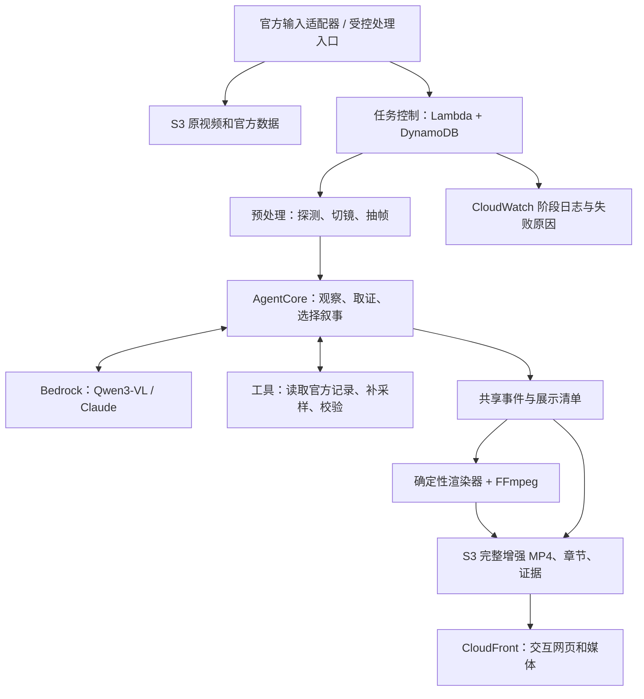

# 关键一拍：冲冠产品与技术方案

版本：2026-10-06 / v1。状态：推荐开发基线，尚未实现正式产品。依据本轮实际读取的正式指南、现有 AWS 实测证据，以及公开训练样片核查；本文中的处理时长、验收阈值和开发排期均为团队目标，不是已有成绩或官方保证。

研究补充（同日）：用户希望与曾实习的上交 AI for Sports 组交流。见[研究借鉴与交流建议](上交AI4Sports研究借鉴与交流建议.md)。BasketballSkills 可为证据关联与工具编排提供参考；BasketEvent 可作为可替换的感知候选，但需要许可、运行与样片验证。保持本文完整成片和交互主线；“篮球领域工具 + Agent”已有相关研究，不作为本队原创性主张。当前未接入这些模型。

产品方向补充（同日）：用户明确交流重点为黑客松产品创新。见[产品创新与学长交流提纲](产品创新与学长交流提纲.md)，推荐讨论“这一拍，你第一眼看谁？”的选择与回放体验，以及解释可点回证据、数据在关键时刻揭示。上述为候选增量，尚未定稿或实现。

## 1. 推荐结论

做 **「关键一拍」：一个把普通 NBA 转播片段自动变成可观看、可探索、可核验的战术回放的 AI 导演。**

核心承诺只有一句：**让观众看懂，为什么最终形成了这次出手。**

观众先看到一次进攻，再由三到五个关键节点看见动作、防守回应、机会变化和终结。每个节点有准确标注和可回看的证据。存在可靠证据时，聚焦未得分者的掩护、接应、牵制或额外传球；如果素材是强投、破压或出色防守，就诚实讲那个故事。

完整增强视频是主作品，交互页面让评委进一步探索，Agent 的自动加工链支撑技术分。产品把篮球专业性、算法加工和视觉表达收敛在同一件事上：**把一个回合解释好。**

## 2. 最新赛题如何决定策略

本轮查到的正式要求比旧培训纪要更具体，详见 [正式指南核准更新](2026-10-06-正式指南核准更新.md)。

|评审|分数或权重|产品应提供的直接证据|
|---|---:|---|
|初赛机器|35|真实 AgentCore 能力、CDK 工程、托管服务协同、完整可重跑链路|
|初赛内容准确性|30|身份、事件、时序、指标与视频一致，每条关键结论可核验|
|初赛体验|25|打开即有完整成片，交互清楚，标签准确且不挡球|
|初赛问答与投篮|10|单独安排队员准备，保留提交值守|
|决赛架构|18|输入、Agent 工具、数据加工、渲染、交付职责清楚|
|决赛实现深度|18|事件对齐、证据约束、稳定标注布局等可复核算法|
|决赛数据准确性|15|同初赛准确性，但能在路演现场解释来源和边界|
|决赛讲解答辩|9|五分钟故事清楚，有实测结果与失败处理依据|
|决赛视觉作品|40|有记忆点的篮球叙事、视频表达、质感、交互和创新|

初赛前八进入决赛，初赛分不带入。决赛只有一轮；准备五分钟讲解，提问时长服从现场安排。因此策略分为两个相接的目标：先用正确、稳定、合规的完整作品晋级，再用一段具有说服力的视觉故事竞争冠军。

三个必须是 **AgentCore、CloudFront 交互 Web、CDK**。正式作品需要完整烧录成片，不能只给浏览器临时标注。资源在赛事账号 `us-east-1`，不执行 bootstrap，角色带指定权限边界。

官方只给出手瞬间点位，没有逐帧轨迹；实时接入、数字孪生、跑动轨迹复原、判罚和博彩预测被排除。把研发预算集中到正确的时间与正确的画面，比建立完整运动重建系统更贴合题目。

## 3. 从真实素材出发，而不是先编一套篮球剧情

本轮从官方公开地址读取训练包，含两段 1080p、约 59.94 fps 的短片，合计约 **44.44 秒**，包内未附 JSON/CSV 深度数据。此前培训口述约 48 秒，应以实际文件为准。它们只用于公开训练样例研究，不能代表考试视频。

抽帧已显示：存在近景切远景、镜头平移、球员遮挡、比分牌和末秒进攻。两段素材都不能简单套入“制造了大空位所以进球”的叙事。具体观察及局限见 [公开训练样片核查](research/公开训练样片核查.md)。

例如，文件名为“弗拉格”的片段可研究突破后的受干扰终结；文件名为“阿门”的片段可研究低进攻时间下的接球、推进和出手节奏。第二段还出现其他球员的 PTS/FG/REBS 转播统计卡，不能把它识别成出手者的官方深度指标。两段比分刷新都可能滞后于动作，不能以刷新帧直接对齐出手。这些观察决定了首版必须具备人物／指标关联和多种叙事选择能力。

Agent 从下列故事中选择画面与数据最能支持的一条：

|故事类型|观众的问题|分析重点|
|---|---|---|
|机会形成|为什么这里出现了可用空间？|掩护、突破、收缩、转移和接应的连续证据|
|压力下处理|为什么最后只能／选择这样出手？|进攻时钟、持球压力、可见接应和实际选择；谨慎使用“只能”|
|困难终结|这次出手究竟难在哪里？|可见干扰、出手方式、位置和真正对应的官方 xFG%|
|防守贡献|即使进球，防守做对了什么？|实际限制了哪些空间或路线，不用结果倒推动作是否正确|

首版定位是“解释真实选择”，不判断唯一最优战术，也不制造“换个选择胜率提升多少”的数字。

## 4. 评委第一次打开会看到什么

页面以比赛视频为主体。首屏呈现已处理的考试片段、一个与素材相符的问题和明显的播放按钮，例如“最后几秒，这次出手机会从哪里来？”

### 4.1 默认观看：自动导演的一次回放

一次点击“看懂这一球”，播放完整增强成片。三到五个节点依次出现，每个节点只传递一个主要信息：

1. **看哪里**：亮起当前相关的一到两名球员，其他画面保持可见。
2. **发生了什么**：一句短解释配合名称、局部强调或已观察关系的箭头。
3. **为什么关键**：在对应时刻显示一项可靠官方数据或一个有依据的战术解释。
4. **怎样结束**：完整呈现出手及结果，区分机会质量与命中结果。

P0 成片保留原片完整内容和时长，先保证数据与视频同步。P1 可增加少量定格、回看和节奏设计，使用显式的原片时间与成片时间映射，仍保留完整回合。不能因剪辑或慢放让标签与官方事件错位。

### 4.2 招牌交互：点击一句解释，回到它的依据

视频下方有三到五张“关键一拍”卡，点击就跳转相应片段。右侧抽屉按需显示：

- **画面依据**：两到三张有准确时间的关键帧，以及对应短片段。
- **官方数据**：字段、数值、适用对象、事件或统计区间。
- **战术解读**：简短说明这些事实支持怎样的理解。

默认界面保持清爽。来源与依据用于回答“为什么相信这条解释”，工程日志和云资源不出现在观赛主屏。

### 4.3 最有记忆点的一张卡

当素材支持时，展示“这一拍，谁容易被忽略？”：选择掩护者、接应者或防守者，画面回到其关键动作，说明可见贡献。只描述行为，不画功劳百分比饼图，不把一次动作任意折算成命中率增益。

强投素材则换成“这一球，防守已经做到哪一步？”；关键在于提出好的篮球问题，而不是强制每球都出现幕后英雄。

### 4.4 体验细节

- 视频约占主要内容区域的 70%，关键节点在下方，证据抽屉默认收起。
- 一键原片对照、慢放、重播当前节点、字幕开关；同一个时间映射驱动所有视图。
- 初始一幕最多一条主句、两名主要球员强调、一项指标。这是信息预算，可据样片测试调整。
- 标签避开球、脸、关键动作和比分牌。镜头切换时旧标签立即撤销，不在错误对象上继续漂移。
- 使用球衣色加形状／文字编码，不能只靠红绿区别；1080p 导出保证中文字体嵌入或栅格化，避免缺字。
- 网页默认读取已生成成品，评委观看不等待模型重新推理。处理入口与观看入口分开，清楚标识结果由哪次输入生成。

## 5. 篮球准确性如何变成产品优势

### 5.1 官方值由数据适配器读，模型不能填数字

每个指标必须有 `source_record_id`、对象、单位和 `scope`。事件级数值才可作为该次出手的值；赛季或全场数值只能按真实范围标注为背景信息。出手瞬间点位不能插值成连续运动或“命中率变化曲线”。

xFG% 的简要含义是平均 NBA 球员在相同出手条件下的预期命中率，不直接等于某名球员本人的命中概率。[NBA 术语表](https://www.nba.com/news/inside-the-game-stat-glossary)

Gravity 与 Leverage 是不同指标，不能继承培训转写中的混用；系统只引用主办方提供且匹配的值。需要更多概念解释时见 [篮球独立评审](research/篮球与产品独立评审.md)，不要照着官方页面自造同名计算结果。

### 5.2 身份和事件必须有依据

身份关联优先使用本场官方名单、事件记录、球衣号与连续画面。不凭模型记忆套球星阵容。确认不了姓名时，用可辨的角色描述并暂停个人指标绑定；这是异常处理，目标仍是把关键球员准确识别出来。

视频播放时间、比分牌比赛时钟、官方事件时间分别存储。回放和慢镜头不能被当成新的进攻，时钟停住也不代表视频时间停止。

### 5.3 用保守的内容发布规则保证准确

一个节点只有在人物、时间、画面标注和主要主张均可核验时进入成片。模型可以提候选，确定性校验和视频／数据证据决定是否发布。第二个模型只做找错助手；两个模型意见一致，不等于新增了一份真实证据。

有画面支持时解释掩护、协防、空切与传球；证据不足时缩短结论。进球不能自动证明选择最好，投丢也不能自动证明战术失败。

## 6. 足以支撑技术深度的两个模块

### A. 事件与官方记录的约束匹配

先由视频产生候选事件，再用可得的球队、球员、节次、比赛时钟和事件类型核对官方记录。若多个记录都可能对应，就保留冲突，不把“最接近”的数字强贴到画面。

保存模型原始候选、校验理由、匹配后的事件和拒绝项。用人工核对的训练事件测时间误差和错误匹配数。这是系统研发测试；考试产物的人工修改仍须服从主办方规则。

### B. 稳定且不挡球的标注编排

对每个标签提出八个周边位置和一个暂隐选项；最多同时三个标签时，组合上限为 `9³ = 729`。基于当前画面锚点，选择遮挡少、连线短、相邻时刻变化小的布局。

内部目标可写成：

`J = w1 × 关键区域遮挡 + w2 × 标签重叠 + w3 × 连线长度 + w4 × 位置跳动 + w5 × 不必要隐藏`

各项归一化，权重用训练样片调试。身份或锚点不可靠、切镜、离屏时，优先关掉该标注。短时定位仅服务视频标签，不输出球场运动轨迹。

用三版对照证明效果：固定头顶标签 → 单帧避让 → 避让加时间稳定。记录已核验片段中的遮挡比例、跳动次数、有效可见时长和耗时；同时报告覆盖率，避免靠隐藏所有标签获得漂亮的遮挡数字。

这两个模块直接帮助内容准确与视觉体验，也能让评委看见“调用大模型之后，我们实际解决了什么”。所有效果数据都应来自真实测试，不能提前填一个提升百分比。

## 7. AWS 与应用架构

推荐 TypeScript / React 负责页面与 CDK，Python 负责视频、数据适配和 Agent；FFmpeg 负责完整成片。先采用已经验证的模型 ID 和服务路径，再逐项验证新增编排及媒体能力。

所有项目基础设施由 CDK 定义，包括 AgentCore Runtime；主办方预置桶和角色按实际要求导入。AgentCore 的 CDK 类已在本地库确认存在，但通过 CloudFormation 创建 Runtime 的账号权限仍要做最小正式验证。

**Agent 的职责**：决定哪些片段需要补看、调用官方数据工具、识别证据冲突、选择可支持的故事、输出受约束的结构化脚本。渲染和数值计算由确定性工具执行。首版使用一个有工具调用能力的 AgentCore Runtime，分阶段完成工作。

**模型分工是待测假设**：先比较两个白名单模型在真实样片上的事件与定位表现，再决定哪个负责主视觉理解。Claude 可承担叙事组织与约束审查，Qwen3-VL 可作为视觉候选；不要根据名称声称某个一定更准确。两个模型均使用 Bedrock 托管，不在 T4 上部署 235B 模型。

**长任务**：客户端先获得任务 ID，再查询进度。阶段结果写入 S3/DynamoDB，失败从阶段恢复。AgentCore 的正式异步状态需按 SDK 实现，不能依赖历史同步测试服务中的任意后台线程。[AWS 异步任务说明](https://docs.aws.amazon.com/bedrock-agentcore/latest/devguide/runtime-long-run.html)

**渲染位置**：先测 Lambda 上的短片 FFmpeg 渲染，并提前打包 Linux 二进制与字体。普通 Lambda 单次上限 15 分钟；以分阶段、短片和受控输入保证预算，达不到时再评估已验证权限的 CPU ECS/Fargate 渲染。不能等考试晚上才迁移计算平台。[AWS Lambda 限制](https://docs.aws.amazon.com/lambda/latest/dg/gettingstarted-limits.html)

**Step Functions**：如果异步阶段、重试和恢复确有需要，作为明确的编排增强引入并提前验证；不同时引入多套队列和工作流只为增加服务数量。基础路径先保持少而清楚。

**GPU**：SageMaker T4 通路已实测，视觉模型和实际视频吞吐尚未测试。GPU 可以用于获准用途的增强实验，不能成为第一份完整成片的前置条件。Processing 配额为 0；Training 成功不能自动证明任意媒体处理作业均获准。

**播放与缓存**：每次运行使用独立产物路径和内容哈希，成功后原子更新发布清单；媒体长缓存，入口清单短缓存。截止前冻结最终版本，评审期间保持相同 URL 可播放。浏览器不保存 AWS 密钥，观看成品无需 AWS 登录。

## 8. 先统一产物，再让前后端并行开发

内部格式可包含以下文件；这些名称是本项目建议，**不是官方评测协议**：

|内部产物|作用|
|---|---|
|`input-manifest.json`|视频哈希、素材 ID、官方数据版本、时长与尺寸|
|`analysis.json`|镜头、事件、身份、证据、匹配记录、通过／拒绝原因|
|`presentation.json`|展示顺序、原片与成片时间映射、布局、字幕和指标引用|
|`final.mp4`|烧录了完整标注的可播放成片|
|`captions.vtt`|可切换字幕，若需要|
|`run-report.json`|阶段耗时、模型版本、自动生成范围、错误和修订记录|

官方评测的入口、参数和产物路径还未得到完整 schema，用单独适配器转换到内部格式。未经核准不对外宣称“已兼容官方接口”。

网页、导出和证据跳转使用同一个时间轴。首版优先 FFmpeg 支持的文字、矢量图层和预渲染局部强调；若再采用 Remotion 等工具，必须先证明完整导出链在比赛账号、时长和资源限制内稳定。

## 9. 功能优先级和明确取舍

|级别|交付内容|完成条件|
|---|---|---|
|P0：有效作品|官方接口适配、CDK AgentCore、真实数据与视频分析、完整烧录 MP4、CloudFront 交互播放器|换输入可重跑，成片可播，数据可追溯；硬性部署条件满足|
|P1：冲冠体验|三到五个关键节点、稳定标签、原片对照、证据抽屉、素材适配叙事|普通观众看懂一处新信息，专业评审能核对；不牺牲准确性|
|P1：深度证明|匹配校验和标注布局算法、对照视频、真实处理报告|同一片段上有可复现的前后结果和局限|
|P2：有余力再加|攻防视角切换、一个关注点互动、可选配音、限定当前回合的问答|P0/P1 已稳定，加入后仍可在处理预算内完成|

明确排除赛题禁止的实时、数字孪生与轨迹复原；不扩展到全赛季数据平台。自由聊天、大量 Agent、持续 GPU 端点、复杂账号系统、没有校准的反事实胜率都不进入首版。

解说文字应自然、简短，术语按需解释。语音是加分体验候选，先保证完整画面和字幕；若使用 Polly 或其他获准服务，提前验证中文声音和生成路径，并声明 AI 解说。没有必要让语音故障阻止出片。

## 10. 开发顺序：每一步形成可验收成果

当前最有价值的第一个开发包是 **一个新输入生成一份完整增强视频，并由 CDK 部署的 AgentCore 参与处理，最终在 CloudFront 播放**。先用公开样片验证技术；赛前准备和正式成果可复用到什么范围，仍按组委会要求处理。

|阶段|任务|过关证据|
|---|---|---|
|A：输入与协议|取得官方数据样例与评测 schema；建立视频探测、输入适配器和事件格式|能解释每个字段、时钟和点位坐标系；缺失项不伪造|
|B：最小出片|一段样片 → AgentCore → 一条可靠标签／指标 → 完整 MP4 → CloudFront|从新输入实际运行的日志、可播放成片及 CDK 资源对应|
|C：篮球内容|关键事件、身份匹配、官方指标绑定、三种以上叙事模板|关键事实人工核对通过，第二段样片无需硬编码时间和姓名|
|D：视觉体验|稳定标注、章节、证据抽屉、对照；统一网页和视频时间|切镜不残留错误标签，拖动与倍速正常，导出与预览一致|
|E：验证与展示|完整耗时测试、异常恢复、最终版本发布、五分钟演练|实际运行报告、备用完整成片、私有仓库与提交入口对应|

2–3 人建议分工：一人负责 Agent／数据／篮球核验，一人负责视频渲染／前端，一人负责 AWS／接口／测试／提交。两人队由第一人兼 AWS、第二人兼演示，比赛最后 30 分钟指定一人只负责交付核验。

第一次算法评估可在一段公开片上调试，冻结配置后用另一段检查新输入适应性。本轮方案研究已观察过两段公开素材，**它们不能宣称严格未见测试集**；真正泛化仍要看新的合规素材和考试视频。

## 11. 比赛当天的时间预算

以下为团队计划，具体活动时刻服从最新赛程。为投篮和问答安排值守，不把午餐和活动时间当成完整连续开发时段。

|时间|必须形成的结果|
|---|---|
|08:20–10:00|核对正式输入与权限，跑通 AgentCore → 完整 MP4 → CloudFront 的最小链|
|10:00–12:00|准确事件和数据绑定；三节点讲解；播放器与章节可用|
|13:15–15:00|稳定标签、证据抽屉和一段有表现力的完整成片|
|15:00–16:15|第二输入演练、异常和缓存、算法对照、记录耗时|
|16:40–17:35|冻结主流程、准备说明与路演、核对 URL 与仓库；保留活动值守|
|17:35–18:00|恢复有效登录，确认配额和素材目录，等待考试视频|
|18:00–18:20|登记考试输入并自动处理，争取第一份完整有效成片|
|18:20–19:00|复核关键事实、指标和标注，按允许规则做有记录的修正|
|19:00–19:30|最终渲染、上传、外网检查，提交有效 URL|
|19:30–19:45|代码、部署和产物版本一致性检查，必要时覆盖提交|
|19:45–20:00|专留提交与故障缓冲；不新增模型或迁移架构|
|20:00–22:20|维持已提交版本和链接可用，避免评审期间变动结果|

短片首版目标 20 分钟、完整质量检查与发布目标 45 分钟，均需在真实链路中测量。如果测不达标，先降低装饰复杂度和模型重试次数，保证准确、完整和可播放。不能把已测 GPU 小矩阵的 199 秒当成视频处理时长。

## 12. 五分钟路演怎么赢得注意

|时间|屏幕内容|讲述目的|
|---|---|---|
|0:00–0:20|原回合最关键的一小段，提出一个好问题|让评委先关心篮球|
|0:20–1:30|播放增强回放，展示三处关键节点|让作品本身证明观众获得了新理解|
|1:30–2:10|点开一句解释，对照画面和官方数据|证明内容准确，推断有边界|
|2:10–3:10|展示标签／数据加工前后对照及实测数字|回应实现深度，避免只有模型调用|
|3:10–4:10|极简架构和真实运行记录，展示一次新输入适应|回应 AgentCore、AWS 协同和重跑能力|
|4:10–4:45|另一个类型的片段或一次失败降级|证明不是只适配一套固定剧情|
|4:45–5:00|回到最有说服力的画面收束|留下“看懂关键一拍”的记忆|

问答准备四个直接答案：指标从哪里来；怎样避免球员／时刻错配；Agent 真正做了哪些决策；新输入出片要多久。每个回答对应真实文件、日志或画面。预先生成的成片可用于稳定展示，清楚说明生成过程，不把预生成展示伪称现场即时推理。

## 13. 达到冲冠质量的内部验收线

这些是内部目标，不换算官方分数：

- 发布内容没有已知的球员误认、事件错配或伪造官方指标；所有官方数值有来源与粒度。
- 每个关键节点都能回到支撑画面；战术解释不超出可见证据与提供的数据。
- 切镜后不会继续显示上一镜头的空间标签；遮挡严重时明确隐藏，可靠后再出现。
- 标签时序与核验事件的偏差以实测毫秒报告，初始目标不超过约 200 ms；不能因采样稀疏而声称逐帧精确。
- 用固定标签作为基线，报告遮挡、跳动、有效可见时长和运行耗时，接受诚实的失败例。
- 换一段合法输入不修改固定姓名、事件时刻或答案；阶段可恢复，运行有完整记录。
- 由未参与开发的人打开网页，完成“播放 → 点关键节点 → 看依据 → 回原片”；看后能复述一个有依据的新理解。
- CloudFront 在无 AWS 登录的浏览器可访问，MP4、音轨、中文、拖动和章节均正常；最终仓库、部署、URL 和素材版本一致。

## 14. 仍需尽早拿到的四类信息

1. 官方深度数据实际文件：字段、点位坐标系、统计粒度、事件与视频对应方式。
2. 机器评测统一调用 schema、产物路径、重跑方式、依赖与最终分支要求。
3. 赛前代码复用、考试期间人工校正、决赛前修改的具体边界。
4. 正式账号续期和评审保留安排、费用／限流，以及成片编码、时长、说明与演示文件规格。

这四项决定适配细节，不妨碍先验证通用输入、Agent 工具、标签渲染和播放链路。当前不启动新的付费资源；下一阶段按实际开发任务验证必要路径。

## 15. 研究依据与配套材料

- [正式指南核准更新](2026-10-06-正式指南核准更新.md)：新评分、硬性要求和旧示例冲突。
- [篮球与产品独立评审](research/篮球与产品独立评审.md)：篮球解释、指标边界、叙事类型。
- [评委视角独立评审](research/评委视角独立评审.md)：评分映射、方案比较和路演检验。
- [工程可行性独立评审](research/工程可行性独立评审.md)：数据格式、模型预算、部署和渲染细节。
- [公开训练样片核查](research/公开训练样片核查.md)：实际文件信息和画面观察。
- [AWS 实测报告](../AWS-Team02-服务实际验证报告.md)：哪些能力已验证、哪些尚未验证。
