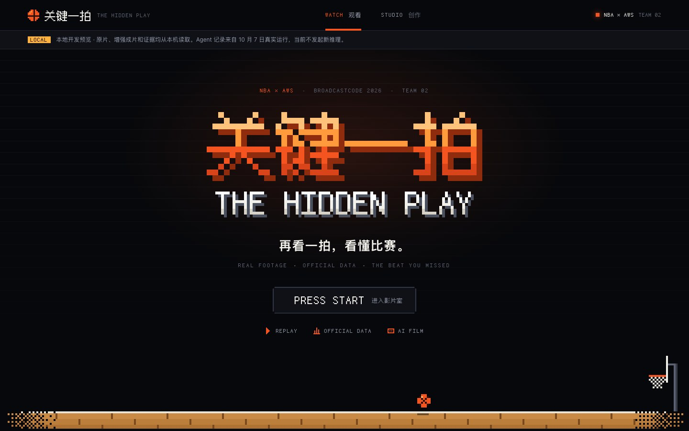

# 关键一拍：像素街机视觉系统（2026-10-09）

用户要求：美国八九十年代 NBA 像素风格 × Apple 极简；减少不必要的文字，加入英文。本轮由 Claude 完成主产品 `product/web/` 与俯视战术板 `product/court-lab/` 的视觉与文案，未改动脚本行为、数据、Agent、Worker 或 CDK。核查记录见[本轮证据](../product/evidence/arcade-20261009.json)。



## 一句话原则

**Apple 负责结构与留白，1990 街机负责油墨与声量。** 像素处理只给游戏里本来就有的东西：字标、卡带、菜单光标、LED 记分牌、能量条、街机按钮。正文、说明、列表保持黑场、发丝线、苹方。

## 令牌

|名称|值|用途|
|---|---|---|
|`--void`|`#07080b`|页面底色，与成片黑边连成一体|
|`--deck` / `--deck-2` / `--deck-3`|`#0f1117` / `#161922` / `#1e222c`|抬起面、未点亮的格子|
|`--line` / `--line-2`|`#232734` / `#323848`|唯一的分隔手段：1px 发丝线、2px 像素描边|
|`--chalk` / `--muted` / `--dim`|`#f2f0ea` / `#8d93a3` / `#5a6070`|正文 / 次级 / 弱化|
|`--ball`|`#f4541f`|唯一强调色：当前状态、主按钮、数值|
|`--ember`|`#8e2c0d`|像素硬阴影与字标挤出|
|`--led`|`#ffb23f`|只用于 LED 记分条、播放时钟与运行中状态|
|`--gold`|`#ffc85c`|俯视板持球人与球路（沿用 `lab.js` 既有颜色）|

## 字体规则

- **FusionPixel12**（随仓库保存，OFL）：英文标签、数字、时钟、按钮主词、字标。它是 12px 网格字体，**只允许 12 / 24 / 36 / 48 / 72 / 96px**，否则会发虚。
- **苹方 / 系统字体**：所有需要阅读的中文句子与标题。
- 不引入网络字体；本地站点与 CloudFront 发布同一份字体文件。

## 双语与精简规则

- **英文是「声音」，中文是「意思」**：像素英文大写短词在前，中文小字在后。例如 `PLAY 播放原片`、`REPLAY ½ 回到关键时刻`、`WATCH 观看`、`ORIGINAL 原片`。
- 按钮、标签页、步骤条、工具栏优先只留一个英文词；需要解释的地方配一句短中文。
- 删掉复述界面状态的句子（例如原片模式下的版本提示）；**来源与边界说明只压缩、不删除**：
  - 主页面保留「画面观察 / 官方数据 / 篮球解读」图例、「编辑选帧」、增强成片模式下的 Agent 生成说明。
  - 俯视板来源说明压成一行 `EDITORIAL SCHEMATIC` 标签；完整方法在页尾 `DATA NOTES` 折叠区。分析区间计数属于诊断信息，保留在 DOM 中但不显示。导入 JSON 属于本地开发工具，收进 `LOCAL FILE` 折叠区。

## 组件

|组件|做法|
|---|---|
|像素字标|`arcade.js` 用 FusionPixel12 在离屏画布上光栅化文字，每个字形像素画成一个方块，CSS 最近邻放大；火焰色分层 + 一级挤出；首次加载溶解浮现。字体加载失败时显示 CSS 版文字。字标文字由 `data-pixel-text` 控制，改名只需改这一处|
|球场带|像素地板、篮架与篮球的卡通循环（运球 → 跳投 → 入网 → +2），15fps 步进；离屏、后台标签、减少动态时停止或画静帧。**不含任何比赛坐标**，不会被误读为追踪结果|
|卡带式案例卡|切角像素框，选中贴 `INSERTED` 标签|
|LED 记分条|琥珀色像素字 + 点阵遮罩，内容由 `app.js` 写入的真实比赛信息|
|关注点菜单|角色选择式菜单，悬停出现像素光标，选中反白闪烁|
|街机按钮|橙底 + 4px 硬阴影，按下位移 4px；禁用时为未通电的暗框，选完关注点后「REVEAL」才亮起|
|xFG 能量条|`app.js` 生成的进度条被切成 20 格，未亮格为暗格；数值用 96px 像素字 + 挤出阴影|
|视频列吸顶|`arcade.js` 把视频列高度写入 `--stage-h`，阅读右栏时视频保持在视野内，底部时间轴不被裁切|

## 文件

- `product/web/arcade.css`：主页面唯一样式表；`arcade.js`：像素字标、球场带、吸顶测量；`test-arcade.cjs`：9 项离线测试。
- `product/court-lab/lab.css`：俯视板样式，与主页面共享令牌（独立文件，便于单独部署）。
- `product/scripts/serve.py`：本地白名单新增 `arcade.css`、`arcade.js`；`publish.py` 按目录发布，无需改动。
- `styles.css`、`broadcast.css`、`atmosphere.js` 不再被主页面加载，仍保留以免影响既有测试；可在之后连同 `test-atmosphere.cjs` 一并清理。

## 已知差距（交给开发侧）

两份已验收成片内的烧录配色仍是旧的柠檬绿 `#cefa58` + `#111410`，与网页橙色不一致。下次真实渲染前，在 `product/worker/handler.py` 的 `render_story()` 中替换为：信箱 `0x07080B`、标题下划线与章节标题 `0xF4541F`、指标值 `0xFFFFFF`、进度条底 `0x323848` / 值 `0xF4541F`、正文 `0xF2F0EA`、来源行 `0x8D93A3`。已验收成片带 SHA-256 溯源，不能在本地重渲替换。

## 预览

```sh
python3 product/scripts/serve.py
```

打开 http://127.0.0.1:4173/product/ 与 http://127.0.0.1:4173/product/court-lab/ 。
