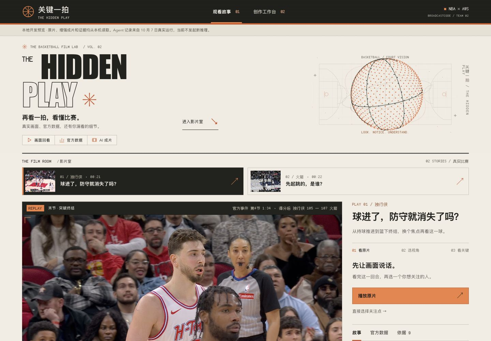

# 关键一拍：旧素材复用与桌面视觉更新

2026-10-09。用户要求优先复用上一场黑客松 `/Users/jack/draftcode` 的前端素材，随后明确只需桌面网页展示，并进一步加强科技与篮球风格。本轮只修改本地产品、测试与说明，未推送或部署。

## 最终视觉

暖纸色 `#f2ede3`、深墨色 `#22231f`、篮球橙 `#ce5728` 构成统一视觉。大标题采用窄体体育海报排版；像素字体用于短标签、时钟与数据，正文保持可读的中文系统字体。观看区与创作区使用相同的编号、按钮、分隔线与视频舞台。

- 复古体育转播：描边字、REPLAY 标签、轻扫描线与胶片颗粒；颗粒只在品牌区，扫描线只在深色页眉。
- 篮球与科技：球场线稿、旋转粒子篮球、网格和仪表角标；画面回看、官方数据、AI 成片三个短提示连起产品能力。
- 影片室：黑色视频舞台、取景边角、橙色章节与回放时钟、分段概率刻度、真实关键帧比较。
- 创作工作台：相同纸色/墨色/橙色风格，保留真实历史工具记录的展开阅读。

粒子球与品牌球场是装饰图形，不含比赛坐标、模型指标或追踪结果；页面取景角标也不是检测框。官方出手图仍仅呈现原始官方单次点位。已有增强 MP4 未重新生成，视频内的原烧录配色保留。

## 从旧项目中复用了什么

以下路径相对于用户提供的旧目录 `draftcode/local_nbadraft_workspace/`。旧项目只读取，没有改写。

|来源|复用方式|当前文件|
|---|---|---|
|`设计元素/01_设计规范/字体资产/FusionPixel12/`|完整 WOFF2 与 SIL OFL 许可证原样复制，二者 SHA-256 均与旧文件一致|[字体](../product/web/assets/fonts/fusion-pixel-12px-monospaced-zh_hans.otf.woff2)、[许可证](../product/web/assets/fonts/OFL.txt)|
|`index.src.html` 的 `.grain`|保留 SVG 噪声滤镜，降低强度，仅限品牌区|[grain.svg](../product/web/assets/grain.svg)|
|`index.src.html` 的扫描线与 `itemIn`|限制扫描线范围；保留轻位移、透明度与短级联入场|[broadcast.css](../product/web/broadcast.css)|
|`绿黑黑客松视觉效果试衣间.html` 的局部 Canvas/DPR 方法，及 `设计元素/03_动效资产/06_三维情绪球.md`|重新实现确定性球体、篮球缝线与旋转投影；加入暂停机制|[atmosphere.js](../product/web/atmosphere.js)|
|`设计元素/02_视觉元素/07_视频展示容器.md`|以真实比赛视频为大舞台，装饰不覆盖核心动作和比分|[index.html](../product/web/index.html)|

没有提取旧 HTML 中缺少完整独立授权文件的得意黑子集，也没有复用旧项目的选秀排名、指标或业务 API。本轮没有引入新的前端框架、依赖包或网络字体。

## 动效边界

Canvas 使用 2D 绘制三维点云投影，不称为 WebGL。桌面容器实际使用 1500 点；小容器使用 680 点，沿用基础窄屏降级但不将手机作为本轮交付目标。DPR 上限为 2；绘制节流至约 30fps；切换后台、滚离视口和空尺寸均停止排帧；系统要求减少动态时只绘制静态球体。字体、纹理、脚本都从本地站点读取。

原 `styles.css` 保留基础布局和功能状态，新视觉统一放在后加载的 `broadcast.css`；原 `app.js` 只调整官方图点位颜色，交互、数值与来源逻辑不变。

本地服务白名单新增所需视觉文件和许可证。未来 `publish.py` 会连同字体发布 `OFL.txt`，该脚本本轮只修改、未执行。

## 验证与证据

[本轮记录](../product/evidence/visual-redesign-20261009.json)保存源码哈希、测试与浏览器核查范围。111 项离线测试全部通过：Agent 19、Worker 8、API 12、数据 16、原交互 34、粒子 10、本地预览 12。

浏览器实测覆盖桌面 1280×900、1440×1000 的布局；1440 首页、剧场、创作历史与官方面板已保存截图。实际核对关注点揭示、弗拉格 16.5 秒定位并暂停、切换增强成片后保留该时点与 0.5 倍速度、两样片 xFG 51.0%/44.5%、历史阿门工具记录展开和本地禁用生成。页面日志检查未见 error/warn。

这些是本地网页验收，不构成新云端生成、任意输入验证、正式机器评分或人类篮球专家认证。新输入与赛事权限仍按[本地开发进度](本地开发进度-20261009.md)推进。
