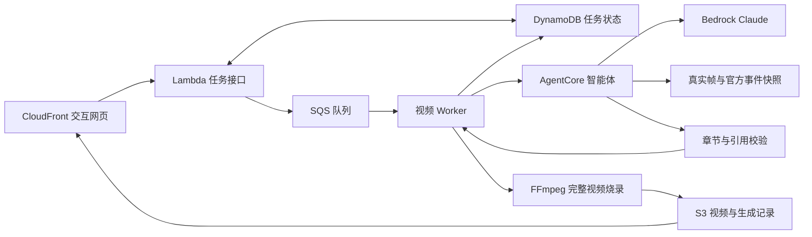

# 关键一拍 · THE HIDDEN PLAY

**10 月10日正式环境：** 新私有 [BroadcastCode-2026](https://github.com/Jackey0903/BroadcastCode-2026) / main 已上传并在Team02 Portal锁定。正式账号为555726205424，活跃目标见[deployment.json](deployment.json)；当前[正式入口](https://deky02484tknr.cloudfront.net/product/)已通过CDK部署并发布媒体，AgentCore READY。正式链路已跑通：弗拉格网页创建／真实生成／完整播放／内容通过，选为展示片；阿门7a2内容拒收保留，观看区沿用已验收历史ce008…并标注historical。本轮按用户要求不追加重跑，见[正式账号验收](../docs/正式账号端到端验收-20261010.md)。最新269项核心门禁通过；此前262项CI成功，最新CI另核对对应提交，旧练习CloudFront不当作当前入口。

**比赛期间持续同步：** 已获用户授权，每个可验收增量整理并推送正式新 `origin/main`，同时本地存档，不逐次询问。评分与排期见[比赛冲刺](../docs/比赛冲刺与评分对齐-20261010.md)，门禁与发布修复见[工程质量](../docs/工程质量与快速迭代-20261010.md)。

一个把“看见进球”推进到“看懂这次出手”的篮球视频产品。观众先看原片并选择关注点，再通过章节回放、官方出手数据和可点击证据发现关键细节。AgentCore 上的智能体按工具返回的证据组织故事，确定性渲染器输出带永久标注的完整 MP4。

## 产品主线与评分对应

**先看进球，再看懂这一拍。** 观看区让评委先选关注对象，慢放同一回合的关键时刻，再看官方 xFG 与可点击来源。创作区展示一次真实的证据读取、叙事组织和完整成片，不把预写案例或装饰性的流程动画当作 Agent 执行。

|需要赢得的判断|产品给出的证据|
|---|---|
|这东西值得球迷使用|观众选择改变揭示文案、回看节点与高亮证据；两个故事各有明确问题|
|篮球内容与数据可信|画面观察、官方数值、编辑解释分开标注；具体事件、比分变化、身份与来源可核对|
|技术真正工作|AgentCore 实际读图与读取官方快照，后续模型轮次给出章节；原始执行记录、模型用量和成片哈希可查|
|展示完整且有视觉记忆点|像素街机 × 极简黑场：像素字标与球场带、卡带式案例、LED 记分条、关注点菜单、xFG 能量条、两张关键帧并排核对、慢放、原片/成片切换、官方出手图和永久标注 MP4|
|系统可重跑、可恢复|CDK、版本锁定、队列任务、失败状态、死信队列与本地源码/媒体存档|

这些是冲刺初赛准确性/交互及决赛视觉/深度的实现选择，不是预估分数或获奖保证。正式机器 35 分仍需拿到官方 schema 后适配并用新输入验证。



## 当前开发结构

- `court-lab/`：[桌面俯视战术示意](court-lab/README.md)，本地弗拉格观看页有入口。覆盖完整 21.548 秒，31 帧编辑锚点、9 段球权、最近位置保留、单视频时钟、半场/全场、持球聚焦与整段轨迹；尚未加入云端发布与 Agent 成片。
- `web/`：无需打包的交互前端，故事揭示、章节回放、原片/成片切换与真实创作任务。
- `web/arcade.css` / `web/arcade.js` / `web/assets/`：当前唯一视觉层（像素街机 × 极简黑场）。像素字标由随仓库的 FusionPixel12 光栅化，球场带为卡通装饰、不含比赛坐标，离屏/后台/减少动态时暂停；规则见[视觉系统](../docs/前端像素街机视觉系统-20261009.md)。`styles.css`、`broadcast.css`、`atmosphere.js` 为旧视觉层，主页面不再加载。
- `data/stories.json`：两段公开练习片的策展案例与来源；不冒充正式赛事评测输入。
- `data/match_events.py`：基于官方记录和已标注视频锚点的事件核对。AI 辅助编辑的锚点和机器校验各自标注。
- `research/`：官方事件响应摘录、视频映射依据与核查报告。
- `agent/`：AgentCore Python 入口、Bedrock 工具循环及共同验证契约。
- `worker/`：队列任务、调用智能体、时间化标注、完整视频渲染与媒体检查。
- `api/`：同源异步任务接口。读取受控注册表并校验合法ID、同桶来源与帧范围，限制公共运行次数；线上当前登记flagg／amen两案例。
- `app.js` / `cdk.json`：更新保留的 `BroadcastCodeTeam02Readiness20261006`，保持既有资源 ID。不要同时从两个版本部署。

## 本地开发预览

以下为保留的独立本地预览，不代理当前云服务。10月10日正式云端另见[当前验收](../docs/正式账号端到端验收-20261010.md)。启动：

```sh
python3 product/scripts/serve.py
```

访问 http://127.0.0.1:4173/product/。仅绑定本机回环地址，预览不读取 AWS 凭证、不代理云请求。原片、关键帧和最终两份完整 MP4 均从本地白名单读取，视频支持 Range 拖动；启动时检查原片及成片 SHA-256。缺少媒体时按[源码保存与恢复](../docs/源码保存与恢复.md)恢复存档，不能只克隆 Git 就假定视频存在。

创作工作台提供「历史成片与处理记录」，保存 10 月 7 日真实工具调用与分析，清楚标明历史结果。`POST /api/jobs` 返回 503，不创建任务；本地入口不启动推理；当前正式云端已有真实任务，但需从正式网址调用并单独验收。观看区仍是编辑策展视角，创作记录来自独立的真实 Agent 运行。

本轮 100 项离线测试及本地 HTTP/媒体检查见[本地测试](evidence/local-tests-20261009.json)与[预览核查](evidence/local-preview-20261009.json)，整体待办见[本地开发进度](../docs/本地开发进度-20261009.md)。

随后完成桌面视觉与俯视战术示意，当时共 184 项离线测试通过。俯视入口 http://127.0.0.1:4173/product/court-lab/，覆盖弗拉格完整 0–21.548 秒，新增持球高亮、阶段解析与最近位置保留；编辑数据、遮挡状态、确定性复现与浏览器证据见[俯视验收](evidence/court-full-20261009.json)。它不使用 GPU、不自动识别十人，也不改变官方出手数据。来源与技术路线详见[俯视工程](court-lab/README.md)。

随后主页面与俯视板统一为像素街机 × 极简黑场视觉，中英双语短标签；最新共 193 项离线测试通过，截图与源码哈希见[视觉核查](evidence/arcade-20261009.json)，规则见[视觉系统](../docs/前端像素街机视觉系统-20261009.md)。

随后的桌面视觉版本共 111 项离线测试通过，含 10 项粒子与新增静态资产/MIME 回归；[视觉验收](evidence/visual-redesign-20261009.json)、[旧素材复用说明](../docs/前端视觉更新与旧素材复用-20261009.md)保存实际截图与功能核对范围。本轮以桌面评委展示为目标，未重新生成 MP4 或部署。

## 快速质量检查

首次安装 `npm ci --prefix product --ignore-scripts` 后，在根目录运行 `python3 product/scripts/check.py --full`。同一命令由 GitHub main／PR 自动执行，检查源码、语法、全部行为测试及正式账号 CDK 模板；快速反馈可用 `--quick`。无视频和云凭证的干净克隆也能运行。媒体层为明确合成占位，模板通过不代表真实 SDK／FFmpeg 部署包、推理或线上验收。详细范围见[工程质量与快速迭代](../docs/工程质量与快速迭代-20261010.md)。

## 正式部署与发布

10 月 10 日正式 Portal 已重新分配账号 `555726205424`。活跃部署目标统一保存在 [deployment.json](deployment.json)，角色保持 `NBAHackathonParticipantRole`、资源区域固定 `us-east-1`，不执行 bootstrap。部署前须通过 `nba` 核对实际身份。当前已实际部署，下面用于后续增量复跑；配置迁移与离线合成本身不代表部署成功，仍须核对当前输出与运行证据。

```sh
npm ci --prefix product
# 仅首次需要：准备固定版本 SDK、FFmpeg 和字体，详见 readiness-lab/README.md。
readiness-lab/.venv/bin/python product/scripts/build.py
cd product
npx cdk diff --profile nba
npx cdk deploy --profile nba --require-approval never --outputs-file outputs.json
cd ..
readiness-lab/.venv/bin/python product/scripts/publish.py
```

CDK 必须保留权限边界 `NBAHackathonParticipantBoundary`。Stack 名及资源 ID 保持原有产品定义，新账号部署会创建该账号的独立实例。发布、任务创建与验证脚本只接受当前 `product/outputs.json`，校验 Runtime ARN 的账号和区域，不再回退旧练习账号输出；任务地址取自新部署的 CloudFront 输出。源码在本机；云端仅是部署实例。构建产物和视频不提交 Git；依赖锁定文件、部署定义、来源证据与测试提交源码管理。

`publish.py` 默认可以初始化空桶，且本轮已真实完成首次发布：先在本地核验并冻结原片、每片六张有 SHA-256 来源记录的关键帧、两份已验收历史 MP4／analysis 及网页，再上传到当前输出指定的桶，同时写入 `config/samples.json` 与 `product/config/samples.json`。发布副本的原片／成片／证据帧 URL 使用当前 CloudFront，原始历史证据不改；每故事的 `publication.historical` 依据实际Runtime区分历史或当前正式任务，保留原始trace，不向任务表注入旧任务。只有当前新任务完成媒体、内容及浏览器核查后才替换观看成片。`--web-only` 必须先确认所有当前媒体、配置和历史分析均完整且匹配，任一缺失就在写入前失败。`--reuse-unchanged` 先完整校验本地计划，再按远端对象字节数、SHA元数据和JSON内容复用未变文件，避免重复上传原片；`--web-only` 与它互斥。`--dry-run` 只检查本地计划，不读取 AWS；它仍需要实际部署输出，不能用旧账号输出。

`publish.py` 对并行训练营保留独立发布门禁：真实数据缺失时，发布副本隐藏CAMP导航，本地源文件保持原样；只有数据与静态依赖完整才发布对应页面。此结构检查不认证训练效果或Agent主流程集成。

首次发布的33个对象、199,878,759字节已实际上传；最新269项核心门禁通过；此前262项CI成功，最新CI另核对对应提交，实际构建包另有[审计](evidence/formal-build-audit-20261010.json)。当前模型任务／媒体／浏览器各自的范围见[正式验收](../docs/正式账号端到端验收-20261010.md)。两个登记训练案例不能替代任意新输入；不要运行硬编码旧账号的 `readiness-lab/upload_inputs.py`。俯视板继续作为本地研究示意，未纳入正式发布。

## 内部接口（非官方评测协议）

- `GET /api/status`：当前服务和登记样片。
- `POST /api/jobs`，JSON `{"sample":"flagg","mode":"story"}`：返回 `jobId`。
- `GET /api/jobs/{jobId}`：状态、真实错误或完成后的 `videoUrl`、`analysisUrl`、分析与验证信息。

CloudFront 的 Lambda IAM 源要求 POST 携带**请求体原始 UTF-8 字节**的 `x-amz-content-sha256`；前端完成这一计算，不持有 AWS 凭证。一次 POST 失败不得盲目重试；按已有 jobId 查询，避免重复计费。原有不带 `mode` 的请求继续走练习流程。

展示案例的视频时间保持原片时间轴。官方出手点位不是逐帧轨迹；故事解读不是因果证明。`xFG` 是该次出手的预期命中率，不是球员赛季命中率、胜率或结果保证。预先由 AI 辅助编辑的案例与模型新生成结果分别标明，不用预写工具轨迹冒充真实执行。

## 从代码重跑

浏览器按钮和命令行使用同一个真实异步接口。下面的命令会启动一次新的模型推理与视频渲染，计入公共运行次数；不得为了读取结果反复提交。

```sh
python3 product/scripts/run_sample.py --sample amen --wait
# 只读取并核验已完成任务，不重新生成：
python3 product/scripts/verify_run.py <真实jobId>
```

`run_sample.py` 对创建任务只发送一次 POST，后续只查询原编号，真实结果写入被 Git 忽略的 `product/build/client-jobs/`。`verify_run.py` 独立下载 MP4、核对 SHA-256、时长、音轨和 HTTP Range；`--promote` 仅在人工/AI 复核内容后使用，用来选为观看区成片。保留失败记录，不能把一次技术完成自动视为篮球内容正确。

## 复现与交付边界

这是基于主办方公开两段练习视频的产品原型。正式评测 schema、正式素材映射、赛前成果复用边界与账号到期后的安排仍以组委会通知为准。用户确认当前没有另外发素材或接口样例，继续用现有两训练片；若后续发新考试输入，须按实际来源登记并重新验收，不能把两个案例通过等同于任意比赛视频均可用。

实际任务、内容拒收、部署与媒体核验见 [产品验收记录](evidence/README.md)。10月7日旧练习最终弗拉格 `81a74837370e46a890cbacb2069074e6` 与阿门 `ce008e75d25d4e2e8e88b57412f6c762` 均已完成内容复核、媒体核验与浏览器完整播放；中间失败与内容拒收记录保留。本轮本地回放不构成新的云端生成验收。

本次代码验收与同步：`1fce2c1`已推送正式`origin/main`，[269项托管门禁](https://github.com/Jackey0903/BroadcastCode-2026/actions/runs/38021795732)成功；源码和38份白名单媒体已在本地存档并验证恢复。
