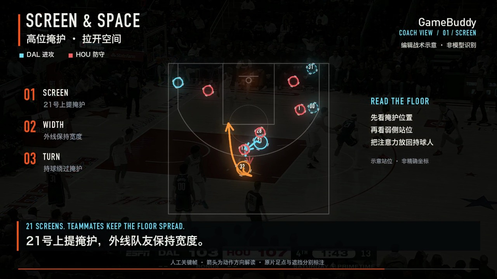
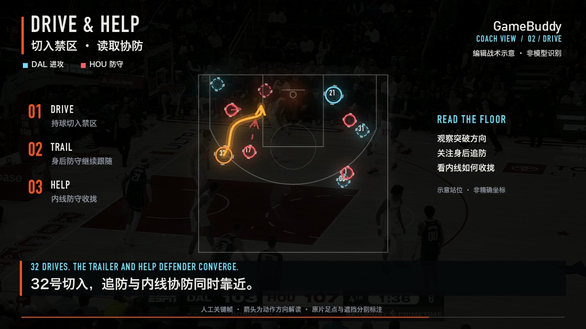

**本地PPT配音新版：** 已把MOSS英文双人解说接到最新55秒英文母版与精修战术板，去除屏内供应商/AI制作说明小字，实际结果与来源见[本轮配音](../../docs/MOSS英文双人解说与PPT成片-20261011.md)。

**最新交付：** 正式55.055秒成片已加入豆包双人AI解说，并由正式AgentCore读取稿件/批准；根CloudFront展示最新玻璃播放器。画面继续复用本库，不重制时间线；见[配音与主页交接](../../docs/正式55秒豆包双人解说与主页发布-20261010.md)。

**55秒最新版本：** 用户要求尽可能1:1复刻弗拉格版出场、结束、进球动画。`python3 product/broadcast-fx/render_formal_assets.py --variant flagg55 --workers 3`直接复用原函数，正式片55.055秒，包含三处战术暂停；输出`product/build/formal-assets/GameBuddy-正式资产联调-v2-55秒.mp4`。详细复用方法及真实状态见[55秒说明](../../docs/正式视频55秒与弗拉格动画复刻-20261010.md)。历史45秒版用`--variant v1`复现。

**正式视频最新入口：** 用户要求完全复用本库的战术表达与动画。正式Christie事件273/xFG30%资产版已在[render_formal_assets.py](render_formal_assets.py)实现，45.212秒完整导出与新watch片尾通过；[formal_scene_renderer.py](formal_scene_renderer.py)直接复用本库的足圈/括号、箭头、俯视板形变、标题与字幕。源片事实/时间线/音轨见[formal/](formal/README.md)，[本轮记录](../../docs/正式素材前端与视觉联调-20261010.md)。下文弗拉格37/45秒为资产来源历史，不能作为正式片输入或数据。

# GameBuddy 视频特效与战术解读资产

本目录接续 Claude 的弗拉格 37.7 秒编辑成片，将渲染代码、标注、音效和战术场景保存为可复用资产。新版时间线增加两个各 **220 帧**的战术定格，合计 **2701 帧 / 45.061683 秒**，1920 × 1080、60000/1001 fps。

此处提供本地编辑与渲染能力。此次新片没有调用 AgentCore 或训练模型，没有新增 AI 配音；声音为原广播音轨与程序生成的 SFX，画面含标明来源的 AI 解读字幕。渲染、完整解码、播放和内容验收状态以当次输出证据为准；保存代码、生成预览或本 README 本身均不表示成片已验收。

## 成片与场景预览

最终文件位于 [GameBuddy-弗拉格战术解读-v3.mp4](../build/broadcast-fx/GameBuddy-弗拉格战术解读-v3.mp4)，[本轮证据](../evidence/broadcast-fx-v3-20261010.json)记录实际导出和播放结果。





机器可读复用入口为 [library.json](library.json)：列出真实模块、函数签名、初始化顺序、图像/音频返回约定、源片绑定和每个组件的使用边界。后续 Agent 可先读取该清单，再按下面的示例调用；清单本身不代表自动分析或成片验收已完成。

## 两层复用方式

| 层次 | 入口 | 用途与调用约定 |
| --- | --- | --- |
| 绘制组件 | [legacy.py](broadcast_fx/legacy.py) | `Layers` 合成、`text_rgba` 文字、`draw_ring` 光圈、`draw_tag` 球员卡、`draw_caption` 字幕、`draw_popup` 动作弹字、`draw_burst` 命中特效、`draw_scorecard` 比分卡及官方出手数据面板。部分组件读取当前片段的标注，需先 `legacy.configure(workdir)`。 |
| 战术图形组件 | [tactics.py](broadcast_fx/tactics.py) | `draw_marker` 足点光圈/身体括号、`draw_path` 动作方向箭头、`project_points` 图形投影、`board_points` 俯视示意布局。调用方提供已核对的输入位置与来源说明。 |
| 已编排的场景 | `tactics.render_scene(name, i, n)` | `T1` 高位掩护与空间、`T2` 切入与协防；先调用 `legacy.configure(workdir)` 和 `tactics.configure(workdir)`。`i` 为场景内从零开始的帧号，本时间线的 `n=220`。 |
| 完整成片 | [render_video.py](render_video.py) | 按 [timeline.py](broadcast_fx/timeline.py) 拼接原片段与战术段，并由 [audio.py](broadcast_fx/audio.py) 在对应帧边界插入音效。 |

所有渲染帧均为 **OpenCV BGR、`uint8`、`(1080, 1920, 3)`**，不是 PIL RGB 图像。颜色常量也使用 BGR；`text_rgba` 返回的文字贴图由 `Layers.paste` 转换合成。帧号均从零开始，时间线区间采用左闭右开范围。每个渲染进程初始化一次配置，不要在同一进程同时切换多个视频的全局配置。

两个场景在原片第 500 帧和第 920 帧之后插入，分别停在该源帧做图形解读，再继续顺序播放原画面；不会将定格时间算作真实比赛时间。完整时间线中的 T1 为输出帧 `[645, 865)`，T2 为 `[1285, 1505)`。

## 从原片复现

以下命令均从**仓库根目录**执行。需要 Python 3.11 或更新版本、FFmpeg、FFprobe。Python 依赖锁定在 [requirements.txt](requirements.txt)；可在项目虚拟环境中安装：

```sh
python3 -m pip install -r product/broadcast-fx/requirements.txt
```

当前资产只适用于原始 `训练_弗拉格2月1日.mp4`，SHA-256 固定为：

```text
9c3e4606d04e7f79e29a112952fcf069ebab202af207af500bfbc3338bc079ce
```

首次准备工作目录，从原片重建 full 与 slow 缓存，并复制持久标注和开源字体：

```sh
python3 product/broadcast-fx/prepare.py \
  --source 'data/reference/train_video/train_video/训练_弗拉格2月1日.mp4' \
  --workdir product/build/broadcast-fx/work
```

已有完整缓存时，可仅同步标注、字体和资产清单：

```sh
python3 product/broadcast-fx/prepare.py \
  --source 'data/reference/train_video/train_video/训练_弗拉格2月1日.mp4' \
  --workdir product/build/broadcast-fx/work \
  --assets-only
```

`--assets-only` 不生成缺失的 full/slow 帧。完整渲染需要原始序号的 `full/fNNNN.jpg` 和 `slow/sNNNN.jpg`，不要对缓存重新编号。预处理沿用原型设置：full 从源帧 0 开始；slow 从源视频 14.9 秒起取 3 秒，以 `minterpolate=fps=179.82:mi_mode=mci:mc_mode=aobmc:me_mode=bidir:vsbmc=1` 生成。慢放渲染对应源帧为 `14.9 × (60000/1001) + j/3`，即约 0.33× 播放。

生成若干预览图，检查两个战术段、官方数据定格和片尾：

```sh
python3 product/broadcast-fx/render_video.py \
  --source 'data/reference/train_video/train_video/训练_弗拉格2月1日.mp4' \
  --workdir product/build/broadcast-fx/work \
  --output 'product/build/broadcast-fx/GameBuddy-弗拉格-45秒.mp4' \
  --preview 700,800,1350,1440,2140,2500
```

预览写入同目录的 `GameBuddy-弗拉格-45秒-previews/`；此模式不生成 MP4。完整渲染：

```sh
python3 product/broadcast-fx/render_video.py \
  --source 'data/reference/train_video/train_video/训练_弗拉格2月1日.mp4' \
  --workdir product/build/broadcast-fx/work \
  --output 'product/build/broadcast-fx/GameBuddy-弗拉格-45秒.mp4' \
  --workers 3
```

渲染器生成 WAV、MP4，并在完整媒体校验成功后写出同名 `.manifest.json`。其中记录输入与输出哈希、代码哈希、时间线、音频采样、帧数/时长和完整解码结果。浏览器是否自然播放至片尾、字幕与篮球内容是否通过验收，应另行保存证据；技术媒体校验不替代这些检查。

原始 37.7 秒声音可单独重建到工作目录的 `out/audio.wav`：

```sh
python3 product/broadcast-fx/legacy_audio.py \
  product/build/broadcast-fx/work \
  'data/reference/train_video/train_video/训练_弗拉格2月1日.mp4'
```

这一步保留原广播并合成本地音效，不会生成语音。原版渲染逻辑另保留 `python3 product/broadcast-fx/broadcast_fx/legacy.py WORKDIR --preview 200,900,1400` 调试入口，其帧号对应未插入两个新场景的旧时间线。

## 组件调用示例

从仓库根目录执行以下代码可生成 T1 的一张图；它与完整渲染器使用同一持久场景：

```sh
PYTHONPATH=product/broadcast-fx python3 - <<'PY'
from pathlib import Path
import cv2
from broadcast_fx import legacy, tactics

workdir = Path('product/build/broadcast-fx/work')
legacy.configure(workdir)
tactics.configure(workdir)
frame = tactics.render_scene('T1', i=150, n=220)
cv2.imwrite(str(workdir / 'out' / 'tactic-T1.jpg'), frame)
PY
```

组件层可以接入 Agent 工具返回的已核对标注。例如下面使用当前 T1 场景已有数据，保留遮挡类型，并把编辑方向箭头投到原画面上：

```python
scene = tactics.SCENES['T1']
layer = legacy.Layers(legacy.src_frame(scene['frame']))
player = scene['players'][0]
tactics.draw_marker(
    layer, player['image'], legacy.CYAN, player.get('number'),
    t=1.0, body_only=player['anchorKind'] == 'body-only',
)
points = tactics.project_points(scene['paths']['D21_screen'], scene['H'])
tactics.draw_path(layer, points, legacy.CYAN, reveal=1.0)
legacy.draw_disclosure(layer, 1.0)
frame_bgr = layer.compose()
```

Agent 接入方负责传入来源、源帧和经过复核的标注，再调用渲染组件；本目录不包含自动识别球员、自动判读战术意图或自动校准相机的服务接口。`project_points` 只执行图形变换，不能将输入升级为官方坐标或真实轨迹。

## 标注与数据边界

活跃战术标注为 [tactics_reviewed.json](data/tactics_reviewed.json)。文件名中的 reviewed 指本轮助手对源帧的视觉核查，**不表示人类篮球专家验收**；每名球员仍保留 `humanExpertReviewed: false`。

- T2 曾误记的 D3 已按可见球衣修正为 D31；号码不可辨认的球员保留 `number: null`，不据站位补身份。
- 可见足点使用 `anchorKind: visible-foot` 与明确 `foot`；足部被遮挡使用 `anchorKind: body-only`、`foot: null`，在原片画面绘制身体括号。俯视示意中的虚线标记不代表观测到了足点。
- `court`、`H` 和箭头均为编辑图形布局与动作方向解读。已移除历史手工 D32 路径末端拼接的官方出手点，官方单次出手数据不再用于延长运动路径。
- 历史 [tac/tactics.json](data/tac/tactics.json) 与 [tac/H.json](data/tac/H.json) 原样保留，仅作来源记录，不是当前场景的活动标注。
- [track.json](data/track.json) 为原型的主角人工关键帧、插值与相机补偿资产；[camera2.json](data/camera2.json) 为画面对齐估计；二者不代表逐帧人工观测或官方追踪。[原始来源工具](data/source-tools/README.md) 供检查算法来源。
- 按用户确认保留 xFG 从 0 递增到 51% 的揭示动画和进度条；动画终值及常驻来源标记均为官方 51%。
- T2 协防方向箭头从视觉核查的远侧 Wb 出发，仅长 2.5 示意英尺，箭头终点不作为实测位置；命中字幕从源视频 17.40 秒才出现。
- 官方出手质量 **xFG 51%** 保留，依据弗拉格对应比赛 `0022500701`、事件 `666`；旧版“同类常见 58%”和相关 RL 对比已删除。训练模型没有用于本次新片，不能把这段编辑成片写成 RL 或 Agent 的生成验收。

新视频必须重新提供并核查源片、人物与号码、可见足点/身体锚点、遮挡状态、帧号、战术文字以及官方事件匹配，建立自己的资产清单。当前 CLI 会拒绝源片哈希不符的输入；不要通过改掉哈希检查直接套用现有坐标。可复用的是绘制组件、编排方式和复现流程。

## 验证

安装本目录依赖后，从仓库根目录运行组件与时间线测试，再运行项目完整离线门禁：

```sh
python3 -m unittest discover -s product/broadcast-fx -p 'test_*.py' -v
python3 product/scripts/check.py --full
```

第一条是本目录独立的10项测试；当前项目完整门禁不自动执行这组需要媒体依赖的测试，两者都应保留。媒体完整解码由实际渲染命令完成，浏览器播放另验收。首次空工作目录的音效生成、来源绑定和重新准备流程也应在换机器时核对。

## 保存与交接

代码、JSON 标注及 [资产清单](data/manifest.json) 纳入 Git，原片、大图缓存、WAV 和 MP4 不入 Git。生成内容统一放在 [product/build/broadcast-fx](../build/broadcast-fx/)；整个 `product/build/` 已被仓库忽略，应连同原片和最终输出清单另做本地媒体备份。其他机器从 Git 恢复代码后，需恢复原片并运行预处理，或恢复已经保存的工作缓存。

字体优先使用本机 macOS 字体，缺失时回退到仓库 [Fusion Pixel](../web/assets/fonts/fusion-pixel-12px-monospaced-zh_hans.otf.woff2)，其 [OFL 许可](../web/assets/fonts/OFL.txt) 随工作目录字体保存；不分发系统字体。无需临时 Claude scratchpad，也不依赖历史临时目录路径。
