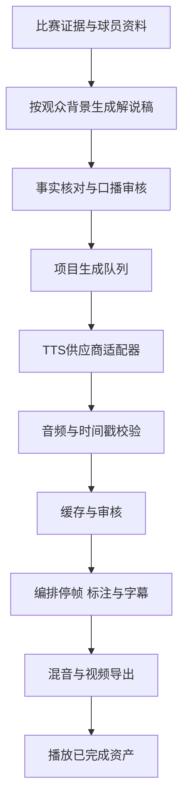

# NBA故事视频：AI语音解说选型与可靠性设计

## 结论与证据状态

记录日期：2026-10-10。适用分支：`experiment/mlb-narrative-rhythm`，独行侠 / 弗拉格 v5。费用不参与本次选型排序。

**建议接厂商API，由后端预先生成、校验并保存音频，再向观众播放已完成的故事。** 当前产品的重点是舒适叙事、停帧与标注同步，适合异步制作。实时语音问答可作为后续独立能力。

1. **首个制作流程候选：MiniMax Speech 2.8 HD。** 理由是HTTP合成、发音控制、停顿与字幕时间戳便于接入当前分段视频流程；这是工程适配判断，不是已测出的中文音质或服务可用性第一名。
2. **中文表达对照：豆包语音合成2.0。** 重点测试语音指令、情绪变化与连续段落表达；若实际部署网络和试听表现更好，可调整为主供应商。
3. **叙述一致性对照：ElevenLabs Multilingual v2；角色表达对照：Eleven v4。** 两者需要分别评测，不能将同一家产品的所有模型视为同一能力。
4. 自部署Qwen3-TTS可后续研究。现阶段自建推理服务会增加部署、GPU调度和模型维护工作，API更适合三人团队先完成产品流程。

本记录的选型结论基于官方文档与本地代码复盘。后续MiniMax已完成真实首轮合成，用户反馈Radio Host音色“太AI”，现转为中文/英文候选试听，见 [MINIMAX-TRIAL.md](MINIMAX-TRIAL.md)。**未完成供应商同稿盲听、并发压测或故障演练，没有依据宣称哪家厂商实际成功率最高、SLA最好。** 本文的完整云端语音系统仍是规划。

**后续听感实测：** MiniMax Speech 2.8 HD英文情绪版已接入约41.14秒完整视频，但用户评价仍很AI、很假，听感验收失败。工程链路成功不代表声音质量合格，见 [VOICE-ISSUES.md](VOICE-ISSUES.md)。

## 1. 稳定性要分开判断

|维度|我们需要的结果|验证方法|
|---|---|---|
|服务可用性|请求能完成，错误可定位，生成任务能恢复|从实际部署区域记录成功率、超时、限流、重试与完成耗时；核对合同SLA和支持机制|
|声线一致性|同一主播各段听起来是同一人，重做一句不突然变音|相同音色与配置重复生成，检查相邻段落和跨日期样本|
|文字与发音可靠性|不漏句、不加词，姓名、比分、年份和术语正确|回转录辅助检查，关键姓名与数字人工试听；转录正确不等于读音一定正确|
|表达可控性|平静讲述、清楚分析、短暂兴奋都符合要求|同稿测试不同表达指令，检查是否出现喊叫、持续激动或音量跳变|
|时间同步|提到谁时高亮谁，声音结束后画面自然推进|核对实际音频时长、时间戳、画面锚点，完整观看桌面与手机版本|
|发布可复现|已审核的视频不会因为再次调用模型而变化|保存最终音频、时间线、参数、哈希和版本，播放使用固定资产|

API输出有波动并不意味着产品播放也必须波动。预生成与版本缓存能使已发布作品固定下来；新作品生成仍依赖厂商可用性。只有合同、目标地区运行数据与质量评审共同支持，才可形成供应商可靠性排序。

## 2. 官方能力与接入注意点

### MiniMax Speech 2.8 HD

[HTTP语音合成文档](https://platform.minimax.io/docs/api-reference/speech-t2a-http)列出`speech-2.8-hd`，支持中文、音色设置、停顿标记、发音控制，以及句级/词级字幕时间戳；非流式支持WAV等格式。API返回的下载URL有效期为24小时，因此需要立即保存到项目存储，不把厂商临时URL作为永久播放地址。

[限流文档](https://platform.minimax.io/docs/guides/rate-limits)当前列出T2A为60 RPM。上线前应以实际账户、模型、接口和所选区域核对额度；这不等于60并发，更不是三名开发者各有60 RPM。

工程建议：首轮使用HTTP非流式请求、固定音色、明确的中文文本与停顿，保存原始响应、音频及字幕。HTTP请求成功之后仍检查业务状态、音频存在且能解码、字幕结构完整。模型允许的最大文本长度不是推荐的解说分段长度。

### 豆包语音合成2.0

[双向流式接口](https://docs.volcengine.com/docs/DoubaoVoice/WebSocketBidirectionalStreaming-V3?lang=zh)描述`context_texts`语音指令和`section_id`上下文关联；能力受音色与模型限制。上下文保留有轮数与超时限制，不能把会话ID当作永久声线配置。

[单向HTTP接口](https://docs.volcengine.com/docs/DoubaoVoice/unidirectional-streaming-text-to-speech-http?lang=zh)也是接入路径。[长文本任务接口](https://docs.volcengine.com/docs/DoubaoVoice/Tasksubmission?lang=zh)采用异步任务模式，可返回字级时间戳。具体采用哪条接口，应按所需音色、指令、时间戳组合做兼容性核对；不能将不同接口参数混用。

[错误码说明](https://docs.volcengine.com/docs/DoubaoVoice/error-code-query-1?lang=zh)包含超并发、请求过大与合成超时等情况，并要求保留Logid用于定位。三人同时生成时需要项目队列和统一并发控制。

工程建议：用选定的正式音色验证平静介绍、停帧分析和短暂兴奋，不先依赖复刻。项目中的自然语言表达要求由适配器映射到实际支持的接口参数，不默认所有音色都能执行同一组指令。

### ElevenLabs

[模型文档](https://elevenlabs.io/docs/overview/models)将Multilingual v2描述为适合长文本一致性的模型；v4面向更丰富的表达与角色对话，两者均支持中文。这些是厂商能力说明，不能作为跨厂商可靠性排名。

[请求衔接文档](https://elevenlabs.io/docs/eleven-api/guides/how-to/text-to-speech/request-stitching)提供分段上下文衔接，但明确不适用于`eleven_v3`；引用请求ID也有有效时间限制。不要默认v4与v2共用所有旧接口能力，接入前核对所选模型和端点。

[Create speech接口](https://elevenlabs.io/docs/api-reference/text-to-speech/convert)说明seed仅尽力保持确定性，不保证结果相同。固定seed不能替代保存已审核音频。

工程建议：用Multilingual v2建立稳定旁白对照，再用v4评测人物表达。字典、上下文与时间戳是否可组合使用，以对应模型当前文档和调用结果为准。

### 其他路线

- [AWS Polly音色表](https://docs.aws.amazon.com/polly/latest/dg/available-voices.html)中普通话Zhiyu支持Neural/Standard，未列出普通话Generative音色。可纳入AWS体系，但中文音色多样性与角色表达不是本次首选条件的最佳匹配。
- [Qwen3-TTS官方仓库](https://github.com/QwenLM/Qwen3-TTS)提供VoiceDesign、CustomVoice、Base等不同模型；指令控制与克隆能力并非每个模型都同时具备。自部署前需另做硬件、吞吐与运维评估，本次未测试本机推理。

## 3. 当前实现中已发现的具体问题

依据`story-plan.json`与`render.py`复盘，字符数为Python `len(narration)`，包括标点、数字与拉丁字母，不代表实际发音字数或实测语音时长。

|当前段落|画面时长|字幕字符数|接语音时需要处理|
|---|---:|---:|---|
|hook|2.50秒|24|开场改成短问句，部分解释移到回到开头后|
|rewind|约1.69秒|19|短回溯可留白，避免为口播强行延长倒放|
|screen-pause|1.30秒|26|与后续5.50秒掩护段合并为连续口播，或明显缩稿|
|roll-pause|2.80秒|30|拆分人物介绍与动作解释，部分讲述延续到后续画面|
|drive|2.50秒|26|动作中只说最重要信息，完整解释放在关键停帧|
|outcome|约2.05秒|38|结果与指标解释重新分配时长，数字规范成口播文本|

这些是时长风险，不是TTS已合成失败的记录。不能直接把全部`narration`按现有段落时长朗读，也不能不断增加停帧来容纳所有文字。

现有渲染器在正常播放段使用原片音轨，停帧和倒放使用静音；尚无TTS生成、音文对齐和混音。已有`sourceTimeMap`可作为时间映射基础，但停帧时长修改后必须重新计算成片时间。原片14秒不等于成片第14秒。

当前原片音轨可能包含转播解说。仅降低整条音轨音量会一起压低现场声；若要保留观众、球鞋与篮球声音，应优先获取独立现场音，否则评估分离效果并检查失真。

## 4. 建议的项目架构

### 分开管理内容、人设、声音和时间线

- `facts`：球员身份、比赛时间、已观察动作、统计来源、分析不确定性。个人风格不能改变事实。
- `persona`：故事型/分析型/现场型，用词、解释深度、幽默与术语使用规则。
- `voice_profile`：供应商、模型、音色ID、语言、表达配置与字典版本。
- `speech_units`：可跨相邻镜头的口播单元，实际音频时长、时间戳、需要同步的球员与动作锚点。
- `timeline`：原片时间与成片时间映射、停帧、标注进出、字幕。按真实音频重新编排。

口播单元与现有视频segment不必一一对应。这样1.3秒掩护停帧可以接着后续动作讲完，不必把短字幕变成长时间静止画面。

### API与制作服务

建议由项目后端提交异步制作任务，TTS worker调用供应商；即使供应商接口同步返回，前端也只跟踪任务状态，不等待长HTTP请求完成。任务状态可设计为：queued、synthesizing、validating、review_required、ready、failed。

统一适配器返回：音频路径、实际时长、采样率、时间戳、厂商请求ID、模型与音色配置。句级/词级/字级时间戳必须声明粒度和相对起点。缺少时间戳时采用音文对齐，并允许人工修正核心动作锚点。

### 三位开发者如何共享

- 三位开发者用各自身份访问同一个项目后端，后端使用项目管理的厂商凭据；不把API密钥放浏览器或Git仓库。
- 音色ID、人物配置、字典和制作任务按项目管理。克隆音色可能属于特定厂商账户，账户迁移和跨供应商切换需重新处理。
- 队列、限流器、存储和任务锁共享。三个本地进程各自限流不能保证共享账户不过限。
- AWS可承担存储与worker部署，也可调用其他厂商TTS。具体部署区域、账户权限和网络连通性仍需实施时验证。

### 播放与切换

- 第一版：每个已审核声音版本输出独立MP4，音画同步清楚、易于复盘。
- 后续：分离视频和解说音轨，使用统一播放时钟处理暂停、拖动、倍速、缓存与结束事件。
- 同稿换音色仍可能改变时长，需要对齐后发布；换语言风格可能改变稿件和停帧，必须管理对应时间线。
- 手动逐帧时暂停故事解说；“重听此处”播放与该关键帧对应的解说单元；恢复故事时定位到对应版本的成片时间。

## 5. 可靠性措施

1. **缓存已审核资产。** 缓存键包含文本、供应商、模型、音色、语速、表达设置、语言、字典与格式；保存音频哈希。模型升级后建立新版本，不覆盖旧成片。
2. **完整保存音频。** 临时下载到任务目录，解码和长度检查通过后原子提交；下载或合成未完成的文件不作为ready结果。
3. **限制重试。** 对可恢复的网络/服务/限流错误采用有上限的指数退避与抖动，遵循服务端建议；鉴权、参数、音色权限错误停止重试。HTTP成功与业务成功分别校验。
4. **任务去重与恢复。** 相同生成键复用已完成结果，进行中的任务用共享锁去重。供应商不保证幂等时，超时重试仍可能重复生成，记录每次attempt与请求ID；不可声称一次且仅一次调用。
5. **选择性连续生成。** 支持跨段上下文的模型按要求生成，保持同一音色与设置；只在厂商允许且不影响连续表达时并行。
6. **避免半途换主播。** 主供应商失败时保留任务并提示重试，观众端继续使用已审核资产。备用厂商生成完整的备选解说版本并重新审核，不自动把单句拼入另一声线的成片。
7. **质量检查。** 检查漏句、重复、超长静音、削波、音量跳变和末尾截断；回转录辅助识别文字问题，球员姓名、数字和情绪仍需试听。
8. **字幕与画面共同验收。** 时间戳只作为起点，关键名字/动作需对照实际语音确认。文字稿改动后重新生成字幕与动作同步。
9. **混音留白。** 统一响度与峰值，解说时压低比赛音轨，间隙恢复现场感；不要求整段持续说话。
10. **可观测性。** 记录任务ID、厂商ID、attempt、错误类别、排队/生成耗时、音频时长、版本和审核结果。监控按供应商/模型/地区区分。

## 6. 下一步验证与验收

以下为计划，不是已完成结果。

### 第一轮：确定声音与接口组合

采用球员介绍、停帧分析、突破终结三种中文稿件。每个候选用固定音色和配置各重复三次，先评估自然度、发音、声线一致性和指令遵循；再检查相邻单元重做一句后的衔接。逐项核对实际返回格式、音频可解码性、时间戳粒度与错误处理，不只听厂商展示样本。

首轮可使用MiniMax 2.8 HD、豆包2.0与ElevenLabs Multilingual v2；v4作为独立角色表达试验。不同厂商参数含义不相同，用等效的表达目标比较，记录各自配置。

### 第二轮：验证共享服务可靠性

从实际部署区域运行三位开发者并行提交场景，观察共享队列与限流。模拟网络中断、worker重启、下载失败和重复提交；确认能恢复、不会发布半段音频或静默换声。记录样本数、成功率、耗时分布和错误，不把小样本观测当作长期可用性保证。

### 第三轮：完成一个真实回合

为弗拉格回合重新写口播，不直接朗读现有字幕。开场保持短钩子，回到推进画面时加入人物身份，再解释持续防守与关键选择。按实测语音编排停帧与标注，完整看一遍，而不是只逐段试听。

建议验收门槛：

- 关键姓名、数字和比赛事实全部人工核对，无漏句、重复或截断。
- 同一版本声音一致，情绪符合故事节奏；局部重做后的衔接经试听确认。
- 核心标注与对应词语同步误差目标不超过200毫秒；这是拟定项目目标，并非厂商保证。
- 声音能完整落在设计时间窗内，优先缩稿或跨镜头延续，不靠明显加速或无节制延长停帧。
- 三人提交不绕过统一限流；任务中断可恢复，已发布作品不受TTS服务临时故障影响。
- 用户整段观看确认叙事和听感；语音接入不自动代表当前画面美观度通过验收。

## 后续工作范围

下一次实施需要：项目厂商账户与音色访问、部署区域和凭据配置、供应商适配器、任务存储/队列、音文对齐、渲染混音与播放同步。当前提交只有选型文档和README入口。

画面质量问题见[VISUAL-ISSUES.md](VISUAL-ISSUES.md)；防守数据与反事实分析见[DATA-PLAN.md](DATA-PLAN.md)。这些问题不会仅靠TTS解决。
