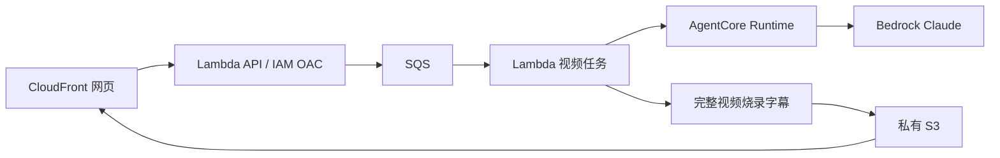

# Team02 赛前完整链路练习

这是赛前准备工程，不是正式参赛成品，也不是主办方统一评测协议。它部署真正的 AgentCore Runtime，使用真实练习视频和模型响应，验证浏览器触发、完整视频烧录、上传与播放。资源保留用于继续开发，历史 `aws-validation/` 的资源已删除。

## 结构



- `app.js` / `cdk.json`：全部基础设施，固定本队账号及 `us-east-1`，含指定权限边界。使用已经完成的 bootstrap，禁止重复 bootstrap。
- `agent/`：内部协议 `team02-readiness-v1`，真实读取来源帧并调用 `global.anthropic.claude-sonnet-4-6`。拒绝伪造深度指标，模型失败真实返回失败。
- `api/`：同源网页入口，只允许两段已下载练习片，不接受任意 URL 或外部凭证；最多启动 30 次测试。队列提交失败有明确失败记录。
- `worker/`：异步调用 Agent、校验来源视频哈希、完整烧录 720p/30fps MP4、保留音频、检查时长、上传产物、结束模型会话。失败不自动重复计费调用，需人工重试。
- `web/`：零构建网页，展示真实状态、来源帧、运行编号、观察和完整 MP4。
- `fixtures/official/`：10 份官网公开参考响应，32 KB；完整来源和哈希见[官方核查](official-source-audit.md)。它们是候选训练数据，视频对应 eventId 尚未核准。
- `prepare_build.py` / `upload_inputs.py`：本地打包与素材上传。仅本地脚本不会部署云资源；后者会向当前工程桶上传素材。

## 在已授权环境重现

先从仓库根目录阅读 `AGENTS.md` 和 `AI接手说明.md`。以下会部署和调用真实 AWS 服务，使用 `nba`，不得使用默认凭证或改区域。

```sh
cd readiness-lab
aws sts get-caller-identity --profile nba --region us-east-1
npm ci --ignore-scripts
python3 -m venv .venv
.venv/bin/pip install -r agent/requirements.txt
.venv/bin/python prepare_build.py
.venv/bin/python -m unittest discover -s agent -p 'test_*.py'
.venv/bin/python -m unittest discover -s worker -p 'test_*.py'
.venv/bin/python -m unittest discover -s api -p 'test_*.py'
npx cdk synth --profile nba
npx cdk deploy --profile nba --outputs-file outputs.json
.venv/bin/python upload_inputs.py
```

账号必须为 `962768510637`、角色 `NBAHackathonParticipantRole`。`upload_inputs.py` 依赖本地之前下载的官方练习包及抽帧（`data/reference/`，不提交大视频）。克隆到新电脑后需按[公开样片核查](../docs/research/公开训练样片核查.md)恢复该素材，不能只复制失效的历史 S3 URI。网页地址由 `outputs.json` 给出；该文件被忽略，最新测试证据会另存到仓库。

FFmpeg 来自 npm 官方注册表 `@ffmpeg-installer/linux-x64@4.1.0`，FFprobe 来自 `ffprobe-static@3.1.0`；中文字体为 Noto CJK 官方仓库，附其 OFL 许可证。二进制包及依赖不提交，哈希保存在本地 `build/tool-sha256.json`。CDK 使用当前注册表版本 2.272.0 / CLI 2.1144.0；该 CDK 包内置的 brace-expansion 有 npm 安全告警且无法自动修复。它只在受控本地基础设施构建中使用，不在网页或 Lambda 执行用户输入；待上游更新后重新核验。

## 测试与外部依赖

本地模拟测试只验证协议和失败处理，不证明 AWS 服务能运行。真实部署、网页按钮、两段完整成片与播放器结果以本轮实测记录为准。练习字幕是基于稀疏图像的模型观察，不是官方数据指标。

仍需主办方提供正式统一评测协议、视频与事件映射，以及练习权限到期后的正式账号安排；这些不能由内部测试协议替代。仓库绑定只能一次，须以 Portal 显示的仓库为最终证据。

## 保留与清理

本轮保留测试 Stack `BroadcastCodeTeam02Readiness20261006`，供继续开发和复核。没有保留 GPU 作业或持续运行的视频计算实例；每次工作任务结束即终止 Agent 会话。DynamoDB 任务记录 TTL 为 7 天，SQS 消息保留一天；S3 输出没有自动删除，不要认为 TTL 会删除 MP4。

如用户以后要求清理，仅清空本 Stack 自建的素材桶，再通过本项目 CDK 删除 Stack；绝不删除 `CDKToolkit`、主办方预置角色或团队预置桶。不要把 `destroy` 放在默认测试脚本内。
