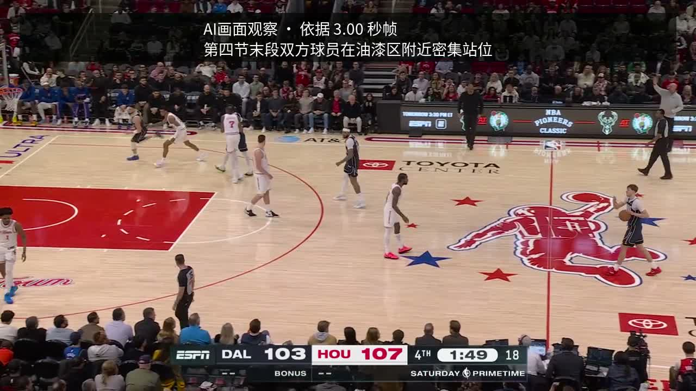
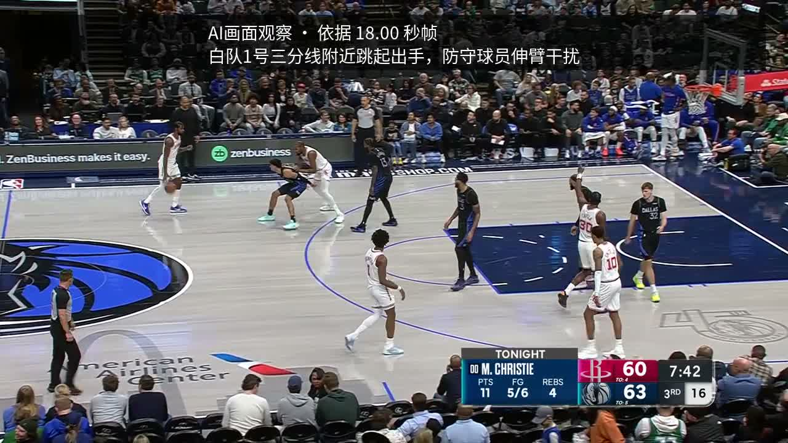

# Team02 赛前准备实测报告 · 2026-10-06

本轮已把“网页调用 Agent”和“练习视频叠字 → 上传 → 网页播放”跑通，并完成 GitHub 仓库授权与 Portal 绑定。可以开始正式产品开发。仍有三项主办方依赖未核准，不能把本轮练习写成正式评测适配完成。

## 当前入口与绑定

- [练习网页](https://d2x8td5d05xg8h.cloudfront.net)：CDK Stack `BroadcastCodeTeam02Readiness20261006`，保留用于继续开发。
- [参赛仓库](https://github.com/Jackey0903/BroadcastCode)：私有，默认分支 `main`。Portal 实际显示 `Your repository is locked in: Jackey0903/BroadcastCode`。
- 赛事 App `nba-aws-hackathon-agent` 仅选择该仓库，权限为读取代码与元数据；旧 `draftcode` 已移出授权范围。用户确认后才保存。详见[绑定记录](repository-binding.json)。
- 尚未在 Portal 提交 CloudFront 作品 URL；该练习网页不是最终参赛作品。

## 手册清单逐项结果

|项目|结果|实际证据与范围|
|---|---|---|
|SSO/CLI 登录、目标账号与区域|通过|使用 `nba`，账号 `962768510637`、角色 `NBAHackathonParticipantRole`；资源位于 `us-east-1`|
|CDK 部署与权限边界|通过|没有执行 bootstrap；Stack `UPDATE_COMPLETE`；API/Worker 新建角色具有 `NBAHackathonParticipantBoundary`|
|AgentCore 承载智能体|通过|真实 Runtime `READY`；任务调用 Runtime，再由其读取 S3 帧、调用 Bedrock Claude；有实际输入/输出 token 记录|
|网页调用 Agent|通过|在 Chrome 选择两段不同练习片并点击启动，网页产生真实任务 ID；页面显示分析、烧录、完成状态|
|完整视频叠字 → 上传 → 网页播放|两段通过|完整 720p MP4、保留音轨，字幕在下载 MP4 的像素内；Chrome 均播放到末尾|
|刷新后恢复任务|通过|阿门页面刷新后仍显示相同已完成任务和 MP4；没有启动新分析|
|GitHub 授权与 Portal 绑定|通过|私有 `BroadcastCode` 已推送、默认 `main`；Portal locked in，App 限定单仓库读取|
|官方深度数据样例|已取得官网参考数据|10 份原始 JSON 随仓库保存，含两位球员合计 41 次候选出手；尚无与剪辑精确对应的 eventId|
|统一评测接口|未取得完整契约|内部 `team02-readiness-v1` 不等于赛事 schema；服务指南没有可直接适配的完整输入输出样例|
|练习权限到期后的安排|未确认|通知期限为 10 月 8 日 09:00；当前可读 IAM 策略未见日期条件，也不能证明续期|

## 两段真实任务

以下结果由网页实际启动，再独立读取云端任务、下载成片、核对 SHA-256、解码检查和浏览器播放。

|项目|弗拉格 · 2 月 1 日|阿门 · 1 月 4 日|
|---|---|---|
|任务 ID|`030eb6203d694a9d9e8a97c25755f9c1`|`4da872a6dac44ad49607b98865c43705`|
|结果页|[打开弗拉格结果](https://d2x8td5d05xg8h.cloudfront.net/?job=030eb6203d694a9d9e8a97c25755f9c1)|[打开阿门结果](https://d2x8td5d05xg8h.cloudfront.net/?job=4da872a6dac44ad49607b98865c43705)|
|处理耗时|46.36 秒|47.77 秒|
|原片时长|21.548118 秒|22.894875 秒|
|独立探测成片时长|21.548005 秒|22.895011 秒|
|成片|1280×720，H.264，音轨保留|1280×720，H.264，音轨保留|
|模型|`global.anthropic.claude-sonnet-4-6`|同左|
|输入/输出 token|5170 / 169|5170 / 167|
|HTTP 分段读取|206，1024 字节|206，1024 字节|
|Chrome 播放到末尾|21.548 秒，恢复播放按钮|22.895 秒，恢复播放按钮|

完整哈希、来源帧 URL、字幕、模型原始观察及部署标识见 [e2e-results.json](e2e-results.json)。人工播放与视觉观察按任务 ID 和成片哈希记录在 [browser-observations.json](browser-observations.json)，不会因一次自动探测就被宣称为通过。

从下载 MP4 解码得到的字幕证据：

这些是模型基于 3、6、15、18 秒四张稀疏帧的画面摘要，全片常驻显示。它们验证烧录流程，不是逐事件字幕、官方深度指标或整段动作识别准确性认证。

### 字幕依据标题修订与回归

首版标题只显示模型引用帧中的第一帧时间，容易误导摘要依据。已改成“AI片段摘要 · 引用帧秒数”，完整列出实际引用帧，并拒绝超限或重复引用。通过 CDK 更新 Worker 后，从网页启动新弗拉格任务 `ee73d53f044543599cf010460b44dc26`：真实 Claude 分析和烧录耗时 48.86 秒，成片仍为 21.548005 秒，Chrome 实际播放到 21.548 秒；独立哈希、音轨、Range 206 和永久字幕检查再次通过。输入/输出 token 为 5170/179。

修订版 SHA-256 为 `fb0d845cde3eab13a392b93982b3908212bbf81aff67ff4a48383b18c23c24d2`。这是独立新产物，未覆盖前两段测试记录。[打开修订版结果](https://d2x8td5d05xg8h.cloudfront.net/?job=ee73d53f044543599cf010460b44dc26)。

## 工程验收

架构为 CloudFront 网页 → Lambda API → SQS → Lambda 视频 Worker → AgentCore/Bedrock → 完整 MP4 → 私有 S3/CloudFront；DynamoDB 保存任务状态。所有资源由 [CDK](app.js) 定义，指定权限边界配置在 [cdk.json](cdk.json)。

- 当前 32 项本地测试通过：Agent 6、Worker 10、API 10、网页 6。初版为 30 项，字幕证据标题修订后新增两项 Worker 测试。测试覆盖协议校验、模型/队列失败、来源限制、引用帧完整性、完整时长与输出校验、前端防重复提交及过期任务恢复。见[测试记录](local-test-results.json)。
- 真实负面检查：无效任务 ID 返回 400、不存在任务返回 404、不允许的样片返回 400。真实网页 POST 使用正确请求正文哈希，可通过 CloudFront 的 IAM 来源访问控制。
- 私有 S3 的四项公共访问阻断均开启；匿名直连 S3 对象和 Lambda Function URL 均返回 403，CloudFront 正常访问。见[部署检查](deployment-checks.json)。
- Worker 日志中两段处理均成功，无任务失败或停止 Agent 会话失败；任务结束后主动停止 Runtime 会话。没有保留常驻 GPU 作业。
- [工具指纹](tool-fingerprints.json)固定媒体工具与中文字体哈希；打包时必须核对。实际素材、大视频、依赖、凭证和含密码 PDF 不提交仓库。

复现步骤见[工程说明](README.md)。[verify_runs.py](verify_runs.py)只验证已有任务，不创建新任务；从新电脑克隆后还需恢复官方练习包及本地素材，不能假定忽略目录已同步。

## 数据与正式评测尚缺的条件

[官方来源核查](official-source-audit.md)记录了 NBA 官网逐次出手接口、原始响应、哈希和字段疑点。两名球员的 `gameClock` 全为空；文件名日期与球员相同不代表 eventId 已精确匹配。坐标是官网球场展示点位，不能直接当成视频人物位置或跑动轨迹。空防守响应也不能当成零压力。

公开 Portal、服务指南与页面实际引用脚本没有提供赛事统一请求、响应、异步状态、产物路径的完整契约。公共脚本内的模拟评分/设计预览不是官方评分细则。本队可继续实现解析、渲染和薄适配层，取得主办方 schema 后再接入。

练习通知的截止时间仍为 **2026-10-08 09:00（北京时间）**。[当前权限核查](account-expiry-audit.json)只表明可读策略没有显式日期条件；SSO 分配、Portal 权限计时及未来政策不在该证据范围内。正式比赛日账号与资源是否保留，需要主办方明确答复。

可直接询问主办方的内容（尚未发送）：

> 请提供两段训练视频对应的深度数据、eventId/视频时间及坐标映射说明，以及统一 Agent 评测的请求、响应、异步状态和产物路径样例；并确认 10 月 8 日 09:00 之后是否续用原账号、何时恢复权限、现有资源是否保留。

## 给下一位 AI 的结论

先读仓库根 [AI 接手说明](../AI接手说明.md)。可以在已验证的云端通路上开发正式产品；不要重新绑定仓库、运行 bootstrap、删除本轮保留 Stack，或把旧 `aws-validation/` 已删除资源当成当前入口。历史 GPU/各服务实测以[原服务报告](../docs/archive/competition-2026/AWS-Team02-服务实际验证报告.md)为准；“目录可列举”“有配额”“实际创建成功”是不同证据，不能据此承诺所有机型和模型均可用。

正式产品仍需准确深度数据叠加、可复现的新输入处理、完整增强成片与评委交互展示。练习链路通过不等于该产品已完成，也不等于正式机器评分已通过。
